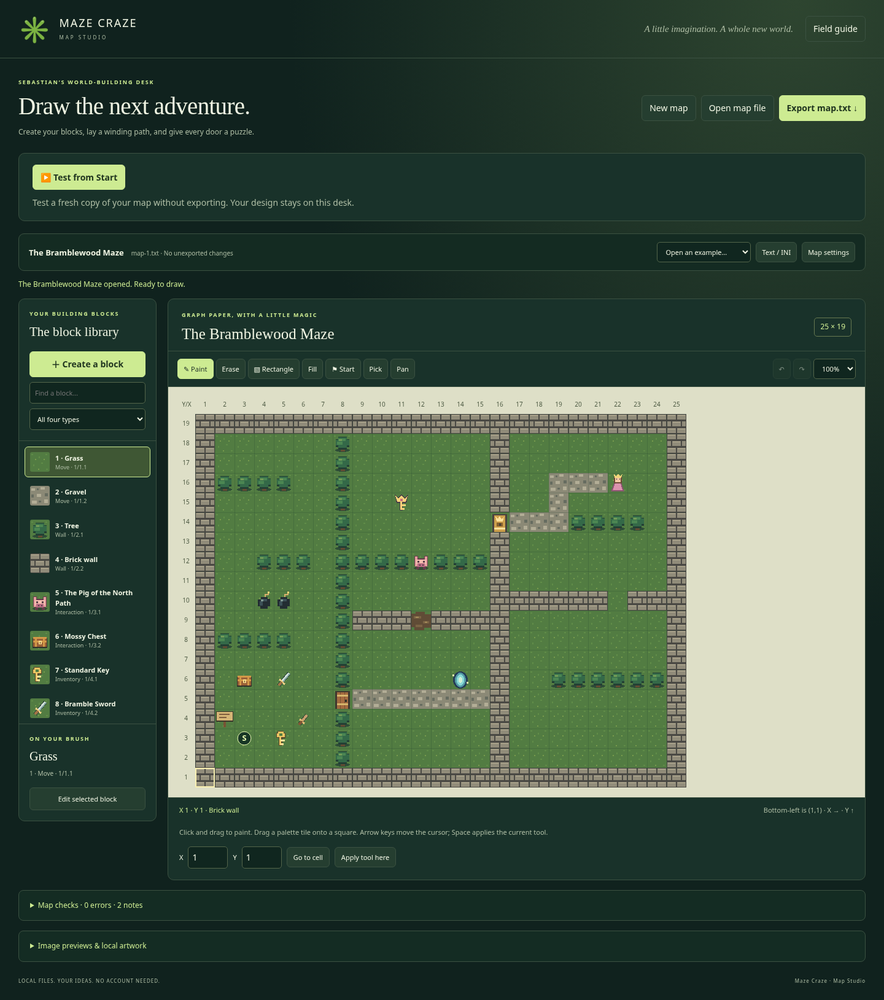

# Maze Craze Map Studio

For a full seventh-grade-friendly manual with screenshots, every field explained,
and puzzle recipes, use the [Word handbook](docs/Maze-Craze-Map-Editor-User-Guide.docx)
or [PDF handbook](docs/Maze-Craze-Map-Editor-User-Guide.pdf). This Markdown guide is
the short reference.

Double-click **editor.html**. You can keep just that one file on your computer:
its scripts, styles, standard tile previews, and both sample maps are inside it.
It can also be served as an ordinary HTML page on your game host. The game still
needs HTTP(S); editing and export do not. Integrated playtesting needs the full
game on the same HTTP(S) origin as editor.html.

## Your first map

1. Choose **New map**, **Open map file**, or one of the examples. Open accepts a
   local UTF-8 `.txt` or `.ini` specification. Your file never leaves your browser.
2. Open **Map settings**. Set the map number, name, dimensions, start coordinate,
   default Move block, border, view windows, variables and output layout. The
   maximum is 100 columns by 100 rows. `(1,1)` is always bottom-left.
3. Choose a block from the library. Click or drag across squares to paint, or drag
   a library tile directly onto a square. The top row has the highest Y coordinate.
4. Double-click a block in the library, or select **Edit selected block**. Use
   **Create a block** to make another Move, Wall, Interaction or Inventory type.
5. Choose **Export map.txt**. This downloads `map-N.txt`, where N is the map number.
   The original imported file is never overwritten. Export regularly: edits are
   held in memory, not saved automatically by the browser.
6. Put the downloaded file in the game's `maps/` folder or upload it to your host.
   The corresponding `Map.N` entry in `main-config.txt` must point to its URL.

Changing dimensions preserves bottom-left coordinates. Shrinking prompts before
cropping cells; choose a valid starting coordinate within the new size. Undo can
restore a resize. Changing the default block replaces existing cells using the old
default, and fills new cells with the selected default.

## Drawing tools

| Tool | What it does | Allowed examples / shortcut |
| --- | --- | --- |
| Paint | Place the selected block; fast drags fill intervening cells | `B`; a row of tree walls |
| Erase | Replace with the map's current default block | `E`; grass instead of a brick |
| Rectangle | Drag a filled rectangular area of the selected block | `R`; a brick enclosure |
| Fill | Replace a connected area of matching cells | `F`; gravel inside a garden |
| Start | Set StartingLocation at a chosen cell | `S`; `(3,3)` |
| Pick | Select the block already at a cell | `I`; choose a hidden interaction tree |
| Pan | Drag the scrollable canvas without painting | `H`; navigate a large map |
| Zoom | Adjust editor display size, leaving game tiles unchanged | `50%`, `75%`, `100%` |
| Undo / redo | Restore whole drawing strokes, settings, or block edits | `Ctrl/Cmd Z`, `Ctrl/Cmd Shift Z` |

With the canvas focused, arrow keys move the editing cursor and Space/Enter
applies the tool at that cell. **Go to cell** and **Apply tool here** provide exact
coordinate controls without mouse placement. Normal form typing retains native
text undo behavior.

## Block definitions and puzzle forms

The block form exposes every currently supported block field. Inventory kinds
are Item, Weapon, and Wearable. Weapon power/hand count and clothing locations
appear for the relevant kind. Inventory pickup choices are built into the game;
define a chest as an Interaction that gives inventory on PASS.

For an Interaction, add choices and select Attempt, UseInventory, or Attack. Add
rules using the fixed subjects/comparisons. The required value may be a full NID,
text, number, or the fixed `Target.RequiredPower` reference. Inventory.Quantity
also has a field for the NID to count. Variable tests expose a variable-name field.
All or Any combines the tests; no tests means automatic success.

Each choice has PASS and FAIL forms for messages, replacement, rewards, states,
transports, end-game status, and variable updates. Both outcomes have **Take
additional items · NIDs separated by |**. A successfully selected regular Item is
already consumed automatically on PASS: do not repeat it in Pass.TakeItems unless
an extra copy is required. FAIL has no automatic removal; Fail.TakeItems is an
explicit penalty, such as a lost gold coin. Blank preserves inventory. Each entry
requires one owned regular Item; repeat NIDs for multiple copies. Clothing and
weapons cannot be taken. Missing required copies abort the whole outcome with an
authoring error and no applied effects. New rewards cannot pay costs in that same
outcome. Replacing with the same Interaction permits another attempt
but does not grant entry; ordinary entry requires PASS plus a Move replacement.

| Form entry | Meaning | Allowed examples |
| --- | --- | --- |
| Full NID | Origin map / category.unique label | `1/3.3`, `2/4.10` |
| Give items | One item per entry; repeat an entry for multiples | `1/4.1 | 1/4.3 | 1/4.3` |
| Take additional items | Explicit regular Item costs on PASS or FAIL | `1/4.1`, `1/4.3 | 1/4.3` |
| Replacement | Full NID; blank PASS means default, blank FAIL means unchanged | `1/1.2`, `1/3.3` |
| Transport | Current-map coordinate, another map/coordinate, or map start | `(12,8)`, `(2)(3,3)`, `(2)` |
| Outcome message | Plain text with approved optional placeholders | `The {SelectedItem.Name} fits!` |
| View windows | Up/right/down/left distances separated by vertical bars | `3333 | 3303 | 9999` |

New blocks get a free index and matching map-qualified NID. Renaming a NID or
renumbering an existing block updates its placements and structured references
within this map. Changing the map number similarly updates its local NIDs. It
does not rewrite text, image URLs, explicit transport map numbers, other map files,
or the master configuration. Update those separately when necessary.

Duplicate makes a new definition and updates self-replacement references in the
copy. Delete replaces placements with the default. Required default/border blocks
and blocks referenced by other choices cannot be deleted until references are
changed. Block **777** is a built-in palette entry for the princess ending and
cannot be redefined.

## Images

The standard image filenames have embedded previews, so they work offline. The
map still exports image paths, such as `../assets/tree.png`, not embedded images.
Those relative paths are resolved by the game against the map file's URL.

For custom art, open **Image previews & local artwork** and select local PNG,
JPEG, GIF or WebP files. The previews match the filenames in the block image
fields. They stay local and are not included in the exported map; upload the
original pictures separately. A later local picture with the same filename
replaces that preview. Large pictures are downscaled for the editor preview only.
Local previews accept up to 64 pictures, at most 2 MB per file and 15 MB per batch;
images must not exceed 4096 pixels in either direction.

URL previews are off by default. Enabling them permits image requests to hosts
named by the map. Use that only for trusted maps/hosts. A base URL can be supplied
for relative paths, for example `https://your-site.example/maps/`. The game
requires HTTP(S) URLs; script, data, and local-file URL schemes are not exportable
image paths. Loading preview pictures never changes your original picture files.

## Checks, imports, and text editing

**Map checks** reports errors and notes. Errors block export; cross-map items,
transport targets, and player variables produce notes because another file must
provide them. Map variables belong to this file and can be edited in Map settings.
Player variables belong to `main-config.txt` and are not edited here.

The editor uses the game's actual specification reader. Faulty layout lines are
skipped using its existing rules; warnings identify the original file line/row.
If an import had skipped lines, review those warnings before exporting a repaired
layout. **Download original imported text** retains access to the unchanged input
until you open a different document. A fatal import error leaves your current map
untouched.

**Text / INI** exposes the complete generated specification for direct editing.
Apply text validates and updates the forms/canvas. Undo can restore the prior
document. Comments are preserved together at the top; their original positions
and whitespace are not preserved. Unknown fields/sections are retained and noted.
Layout exports are regenerated from the grid: shorthand uses horizontal runs of
nondefault blocks; longhand writes every row from highest Y to lowest Y. Both
represent the same map, though original shorthand ordering is normalized.

There is no script execution from specifications, HTML rendering of messages,
file upload, server storage, or external runtime library. See SPECIFICATION.md for
the format reference.

## Test, pause, and resume

Open editor.html on the same HTTP(S) website as the full game. Apply form changes,
then choose **Test from Start**. The editor passes an in-memory text snapshot to
an iframe running the existing index.html and game modules. It does not upload
that text, change your design, or mark your map as exported. The edited map starts
at its own StartingLocation, even if the master StartMap is different. Every new
test resets inventory, equipment, states, variables, and all visited map changes.

**Back to Edit** pauses that iframe, including any open interaction dialog.
**Resume Test** keeps the old run and old map snapshot. When the map has changed,
the editor explains that Resume continues the previous test; use **Test from
Start** to include your edits. Pause waits until asynchronous interactions/map
loading finish. Undo and the authoring document remain separate from test progress.
Reloading/closing the editor loses both unexported work and the paused test.

Master images, style and player-variable defaults still come from main-config.txt.
Other maps and foreign item definitions come from its map directory. A new edited
map can be tested without a directory entry: its artwork then resolves relative
to `maps/map-N.txt` beside the game. If a directory entry exists, its URL is the
artwork base. The image-preview base URL and local preview artwork are editor-only;
upload custom pictures separately for the game to load them. Cross-map tests use
the other maps' server files, not unsaved documents in other editor tabs.

The editor-only ZIP still supports offline editing/export. For integrated tests,
install the full project ZIP, including js/playtest-protocol.js. Messages require
an exact origin, expected parent/iframe window, protocol version and session ID;
the map remains data. All requests load ordinary static files. Publishing remains
your separate download-and-SFTP workflow.

## Editing the editor

Work in `editor-shell.html`, `editor.css`, `js/editor-model.js`, and
`js/editor-app.js`, plus the shared `js/playtest-protocol.js`, then run `npm run build:editor`. That small Node script embeds
the shared parser, source, style, standard tile previews and sample maps into the
distributed `editor.html`. The built file is committed, so no build or dependency
installation is needed to use the editor.

Run `npm test` for model/game checks and `npm run test:editor-browser` for browser
checks. The managed test browser blocks file URL navigation; the offline test
loads the same HTML into an opaque-origin document, verifies no HTTP requests,
and exercises native file input, download, drawing, forms and large/mobile maps.
The game browser suite also checks the editor reached through its hosted link.
