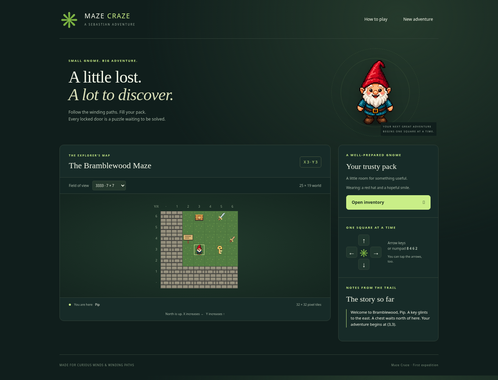

# Maze Craze — first expedition

Sebastian's graph-paper puzzle adventure: a happy gnome, 32×32 pixel tiles,
one-based Cartesian coordinates, editable INI-style text, and no combat randomness.
There is no runtime library, account, analytics, database, or build step.



## Play locally

From the MazeCraze directory, run:

```sh
python3 -m http.server 8000 --bind 0.0.0.0
```

Open your browser at the server's address on port 8000. Opening `index.html` directly
as a `file:` URL will not work: browsers restrict fetching the text specifications.
`npm start` runs the same server if Node is installed. This server is for development;
use ordinary HTTPS static hosting for the published game.

Enter a nickname. Move with arrow keys, numpad 8/2/4/6 (Num Lock on or off),
or tap the on-screen arrows. Each fresh key press moves one cell. Movement pauses
during dialogs. Use the pack to WEAR boots and WIELD weapons before interacting.
Change field of view with the dropdown; large windows scroll within the map panel.

Progress stays in memory until a reload or a new adventure. Returning to a map
preserves its changes. There is no save-to-disk feature in this draft.

## Where to make changes

| File | Purpose | Editing examples |
| --- | --- | --- |
| `main-config.txt` | Map directory, starting map, player image, presentation | Add `Map.3: maps/map-3.txt` |
| `maps/map-1.txt` | First maze, block definitions, choices, placement | Change a key's location or door rule |
| `maps/map-2.txt` | Optional clearing and return gate | Change its chest rewards |
| `assets/*.png` | Ready-to-use tile pictures and gnome | Upload these to WordPress |
| `assets/*.svg` | Editable originals for the small tiles | Change colors or shapes |
| `js/spec.js` | Text reader and validation | Approved specification vocabulary |
| `js/engine.js` | Movement, equipment, tests, outcome rules | Game mechanics without display code |
| `js/app.js` | Browser controls, dialogs, loading | Main config URL near the top |
| `styles.css` | Page and popup appearance | Layout, spacing, colors |
| `SPECIFICATION.md` | Author's format reference | Rules, outcomes, coordinates |

## WordPress deployment

The simplest reliable approach is to serve this folder as a small static game and
embed `index.html` using an iframe in a WordPress **Custom HTML** block. The iframe
isolates game styles and arrow-key handling from the WordPress theme. A starter
snippet is in `wordpress-embed.html`.

1. Put `index.html`, `styles.css`, `js/`, `assets/`, `maps/`, and `main-config.txt`
   together on an HTTPS static host or in a static directory managed through your
   WordPress hosting file manager/SFTP. Keep their relative structure. Do not use
   Python's development server for this deployment.
2. Replace the example iframe URL in `wordpress-embed.html` with the actual game
   page URL and paste the snippet into the WordPress page's Custom HTML block.
3. If keeping everything together, no JavaScript edits are necessary. If instead
   uploading text and PNG assets to the WordPress Media Library, copy the resulting
   URLs into `main-config.txt` and the map files. Then change the clearly commented
   `MAIN_CONFIG_URL` near the top of `js/app.js` to the uploaded master text file.
4. Relative URLs in the master configuration resolve against that file. Relative
   image URLs in each map resolve against that map file. WordPress may rename files
   or put them in different month folders, so use the actual copied URLs when split
   across Media Library locations. Fetching a different origin requires that host
   to permit CORS. Keeping files on the game origin avoids that requirement.
5. Check the embedded game on desktop and a phone. Click inside the game to give it
   keyboard focus. If a host caches text files, clear that cache after changing a map.

WordPress permissions, hosting policy, and security plugins vary. The Media Library
often rejects HTML/JavaScript and SVG; uploading them as media is not the deployment
method used here. The game uses PNG pictures and `.txt` specifications, but your
administrator must still permit those file uploads. A host must serve modules with
a JavaScript MIME type and serve HTML as a page, rather than an attachment. Do not
enable unrestricted uploads to work around a rejection. No WordPress installation
or upload credentials were supplied, so deployment to your actual site is untested.

## Puzzle behavior

- Move enters a cell. Wall blocks it. Interaction presents choices. Inventory
  presents pickup/leave choices. Wall and Interaction trees can use identical art.
- PASS applies its outcome and replaces the cell with the specified block or the
  current map's default Move block. Only a resulting Move block grants entry.
- FAIL never grants entry. It preserves the selected item and normally preserves
  the interaction; an explicit failure replacement can change the cell.
- Keys/bombs are consumed one at a time, only on a successful selected-item use.
  Clothing and weapons remain owned. Possession/equipment checks consume nothing.
- Explicit transports override ordinary entry. Arrival never triggers a cell,
  including a wall or another portal. Invalid coordinates use that map's start.
- Block index 777 is reserved: it immediately saves the princess and ends play.

## Tests and development tools

The rules tests use Node 20+ and no downloaded dependencies:

```sh
npm test
```

For browser testing, install the pinned development dependency with `npm ci`.
Keep the local server running in another terminal, then run:

```sh
npm run test:browser
```

The browser test uses `/usr/bin/chromium` when available. Otherwise install a
Playwright browser with `npx playwright install chromium`, or set `CHROMIUM_PATH`
to an existing Chromium executable. `MAZE_TEST_URL` selects a different test server.
The browser test completes the maze through real controls and exercises failed
matches, equipment, map travel, the secret tree, the ending, mobile controls,
asymmetric views, nickname injection safety, and missing requests. Screenshots
are written to the ignored `test-results/` directory.

To refresh PNGs after editing the original SVG tiles, use:

```sh
npm run assets:png
```

No npm dependencies need to be uploaded to the game host.

## First-maze guide (spoilers)

Start at `(3,3)`. Pick up the standard key at `(5,3)`. The chest at `(3,6)` gives
boots. The sword at `(5,6)` has power 8; the wooden dagger at `(6,4)` has power 2.
Wear the boots and wield the sword through the pack. The standard door is `(8,5)`.
Cross the mud at `(12,9)`, then defeat the pig at `(12,12)`. Collect the master
key at `(11,15)`, open the master door at `(16,14)`, and find the princess at
`(22,16)`. The strong sword must have power **greater than** the pig's requirement 6.

Bombs at `(4,10)` and `(5,10)` can reveal the tree shortcut at `(8,14)`. The portal
at `(14,6)` leads to map 2, whose supply chest at `(7,5)` contains a spare standard
key and two bombs. Its return gate is `(3,3)`. These are optional exploration paths.

## Security and deliberate limits

Text configurations are data: no scripts, HTML, arbitrary CSS, or executable rule
expressions. The interface inserts messages and nicknames as text. Rule subjects,
actions, comparisons, fonts and outcome types are restricted. Definitions must use
map-qualified NIDs. Dimensions are limited to 100×100, view distances to single
digits, and each configuration response to 2 MB with a request timeout. Failed
destination loads leave an interaction unapplied. URLs must be HTTPS, except
same-origin HTTP for local development; fetches omit credentials and referrers.

Maintain trusted configuration/image hosting. This static client game is not an
anti-cheating or server-authoritative system. This iteration has no health,
random battles, nested rule groups, persistent saves, map editor, sound, or touch
swipe controls. There are on-screen touch arrows.

The gnome is original generated artwork. The 18 other tiny tile designs were made
for this project; SVG sources and raster PNG exports are included.
