# 1. Welcome to the mapmaker’s desk

Maze Craze Map Studio turns your graph-paper ideas into playable puzzle maps. You design the world: where the gnome starts, which paths are open, what a chest contains, and what a player must discover to get through a door. The editor helps you write the map specification correctly. A specification is a list of instructions and descriptions that the game understands.

This handbook is written for Sebastian, Esther, and other mapmakers, with explanations for a seventh-grade reader. You do not need to write JavaScript to use the editor. You will learn a little about coordinates, careful naming, logic, and testing. Those skills let you build increasingly clever adventures without changing the game program.

Read Chapters 1–4 first and make the small practice map. After that, use the field reference in Chapters 5–11 whenever a setting is unfamiliar. Chapter 12 is a recipe book of puzzle ideas. The remaining chapters explain artwork, files, publishing, testing, and troubleshooting.

## The editor and the game are two different tools

**The editor** is `editor.html`. Double-click it to open it in a modern browser. Its JavaScript, styles, standard picture previews, and two example maps are inside that one file. It can work offline without Python or a web server. You can also upload the single file to an ordinary HTML-capable web host.

**The game** is `index.html`, together with its JavaScript, artwork, and configuration files. The game loads map text and JavaScript modules, so it needs an HTTP or HTTPS server. Opening the game directly from a Windows `file:///C:/...` address causes a browser security error. That restriction does not apply to the self-contained editor.

When editor.html is on the same HTTP(S) website as the full game, Test from Start runs the existing game right inside the editor. No export is needed for that test. Offline editing still works; offline playtesting does not. A map can be written correctly but still have an impossible puzzle, such as a key behind the door that needs it. Chapter 17 explains how to test, pause, edit, resume, and restart.

## The most important habit: apply, back up, and test

Think of three different kinds of saving. **Save block** puts the block form’s changes into the current editor document. **Apply settings** does the same for the map settings. Neither button writes a file to your computer. **Export map.txt** downloads the actual map file.

There is no automatic disk save or automatic browser backup. A browser may warn before you leave with unexported changes, but do not depend on that warning. Export after each useful milestone. Opening another map starts a different editing document and resets its undo history.

> MAPMAKER’S HABIT: Keep a working copy, an exported backup, and a tested game copy. Name backups clearly, such as map-3-before-secret-tree.txt. The name you actually publish must match the URL in the main configuration.

## Playing in the compact map screen

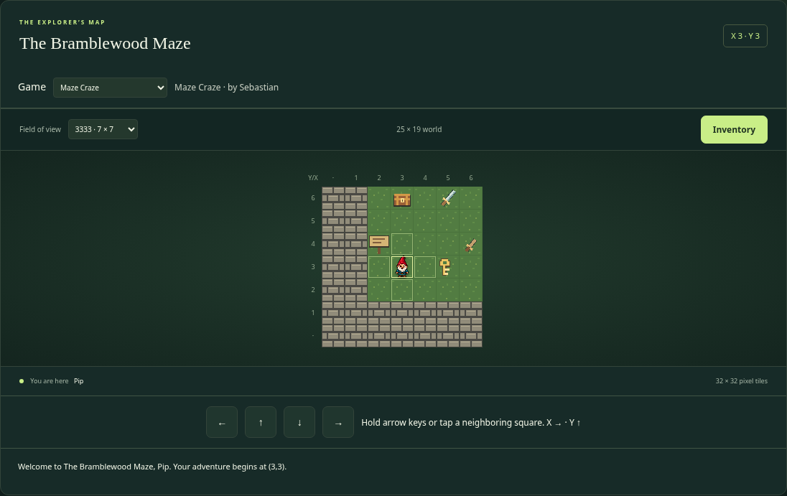

The game uses one wide map panel. Its toolbar contains the game selector, view window, coordinates, and Inventory button. Four compact direction buttons stay beneath the grid. The latest story message appears underneath; each new message replaces the last, while ordinary walking leaves it visible. The old right-hand sidebar is gone.

A fresh keyboard direction moves immediately. Keep holding it: after 300 milliseconds the game moves again, then every 200 milliseconds. Releasing the key, meeting a wall, opening an interaction or bag, pausing, or leaving the browser stops the timer. Press again to continue after a popup; the game will not resume a forgotten held direction.

Click or touch a square directly above, below, left, or right of the character to attempt one step. Walls and interactions behave exactly as with keyboard movement. Clicking the player, a diagonal, or a distant square does nothing. Adjacent squares have the same subtle outline regardless of their block behavior, so secret interaction trees are not revealed. Hidden directions in an asymmetric view window remain available through the keyboard or buttons.

Tiles remain 32×32 pixels and ViewWindow still controls the visible square count. A wider panel provides space; it does not grant extra vision automatically. Large windows scroll within the panel on smaller screens.

## A few words you will see often

| Word | Plain-language meaning | Allowed examples |
| --- | --- | --- |
| Cell | One square on the map | The square at (6,4) |
| Block | A definition of what a cell contains or does | Grass, a wall tree, a locked door |
| Placement | One occurrence of a block in the world | The chest at (3,6) |
| Choice | A button offered during an interaction | Try a key; attack with a sword |
| Test | A question the game can answer true or false | Does the chosen item have NID 1/4.1? |
| Outcome | What happens after the tests pass or fail | Show a message; give boots; replace a door |
| Inventory | Everything the player owns, including equipped items | Two keys, boots, and a sword |
| NID | A complete name tag for a definition | 1/4.1 |

# 2. Coordinates, block types, and name tags

## Your map is a coordinate plane

Every coordinate is written X first, then Y: `(X,Y)`. X counts columns from left to right. Y counts rows from bottom to top. The bottom-left square is `(1,1)`, not `(0,0)`. Right adds 1 to X; left subtracts 1. Up adds 1 to Y; down subtracts 1.

On an 11-column, 9-row map, the four corners are `(1,1)`, `(11,1)`, `(1,9)`, and `(11,9)`. The editor draws row 9 at the top because you are looking down at the world. A coordinate such as `(12,4)` is outside that map.

Try pointing to `(3,2)` on your paper. Move two squares right and one up. You arrive at `(5,3)`. Notice that you changed X and Y separately. The gnome moves one square at a time, in four directions, with no diagonal movement.

## The four block types

| Type | What an attempted move does | Allowed examples |
| --- | --- | --- |
| Move | Enters the square immediately | Grass, gravel, an open doorway |
| Wall | Blocks movement without offering choices | Solid brick, an ordinary tree |
| Interaction | Opens a popup with choices and tests | Mud, a chest, a door, a pig monster |
| Inventory | Offers the built-in pickup/leave choices | A key, bomb, sword, or pair of boots |

A cell contains exactly one block. There is no second editable ground layer underneath a sword or chest. On successful pickup, the game replaces that cell with the map’s default Move block. An Interaction can specify a different replacement for success or failure.

The player avatar is drawn over its current cell. It is not a block you paint into the map. The Start tool places a starting-location marker, not an avatar object or a second cell layer.

## A hidden tree can look exactly like a wall tree

A Wall tree and an Interaction tree may use the same picture. The Wall tree never offers a bomb choice. The Interaction tree can offer choices when the player tries to walk into it. This lets you hide a shortcut among ordinary trees.

The picture does not decide the behavior. Type, choices, tests, and outcomes decide the behavior. Give two differently behaving chests different block definitions if they need different contents. Multiple placements of the same chest definition have the same starting contents, but opening one changes only that particular cell.

## Block index, NID, and coordinate are different

| Identifier | What it identifies | Allowed examples |
| --- | --- | --- |
| Map number | One map file’s identity | Map 1; Map 3 |
| Block index | A local shortcut used by that map’s layout | Block 10 in [Block.10] |
| Full NID | The originating definition, even across maps | 1/3.3 for a door; 1/4.1 for a key |
| Coordinate | Where a placement is located | (8,5) |
| Choice number | A choice belonging to one block | Choice 1 of Block 10 |

For example, `(8,5)10` places block index 10 at coordinate `(8,5)`. The definition `[Block.10]` might say `NID: 1/3.3`. A choice might test whether the player selected `1/4.1`. These numbers are connected, but they are not interchangeable.

Read `1/3.3` as “map 1, Interaction definition 3.” Before the dot, categories are 1 for Move, 2 for Wall, 3 for Interaction, and 4 for Inventory. The number after the dot distinguishes definitions in that category.

The NID is text, not a decimal calculation. `1/4.10` and `1/4.1` are different items. Always include the map number in definitions and references. Do not type quotation marks around an NID. Definition NIDs must belong to the map being edited and match the definition’s Type.

> CONNECTION: A map 1 key keeps NID 1/4.1 when the player travels to map 2. A map 2 door can accept it by testing 1/4.1. It does not become 2/4.1 just because the player changed maps.

# 3. A tour of every editor control

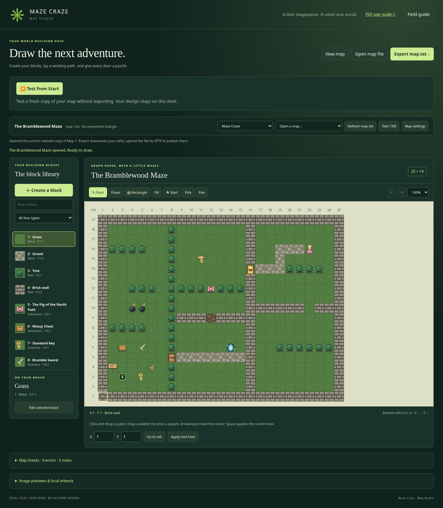

## File and document controls

**New map** starts a grass-filled 21×15 world with starter grass, gravel, tree, and brick definitions. You can change that size immediately in Map settings. If the current document has unexported changes, the editor asks before replacing it.

**Open map file** opens a local file picker. Select an existing `.txt` or `.ini` map file. The editor reads it in your browser; it does not upload it. The file must be a map specification, not `main-config.txt`, a ZIP, or a picture.

**Open a map…** has two groups. On your game website, Website maps lists every map defined in main-config.txt. Select one to open its current server file. Bundled examples contains the two offline samples, Bramblewood, Map 1, and Little Clearing, Map 2. The samples are separate copies and may differ from your published maps. Opening either kind changes only the editor document; it does not save anything back to the website.


**Refresh map list** rereads main-config.txt without replacing your editing document. Use it after SFTP adds Map.3 or Map.4 to the master directory. The initial labels show the map number and filename; after opening a website map, its label uses the map name. The editor fetches map text when you choose a map, rather than downloading every map just to fill the list. Reopening a map requests the current server copy again.

| Dropdown group or control | Where its data comes from | Allowed examples |
| --- | --- | --- |
| Website maps | Map.N entries in the master file beside the hosted editor | Map.3: maps/map-3.txt |
| Bundled examples | Samples saved inside editor.html | Bramblewood, Map 1 |
| Refresh map list | Reads the website master directory again | Discover Map.4 after SFTP upload |

**Try the website workflow:** Put Map.3: maps/map-3.txt and Map.4: maps/map-4.txt under [Maps] in main-config.txt, and upload those map files. Open the hosted editor or click Refresh map list. Select Map 4 under Website maps. Change a block, export map-4.txt, and SFTP that download to the Map.4 URL to publish the new design. You do not need to alter StartMap just to open Map 4 in the editor.

The directory number must match the file’s Map.ID. An entry for Map.4 cannot point to a file that defines Map 3. Map URLs are relative to main-config.txt, as in the game. A custom URL such as maps/fourth-maze.txt is allowed, but Export still downloads map-4.txt: rename it or choose the correct destination when uploading so you replace the file the directory actually references.

The editor asks before replacing unexported changes. A missing, invalid, or mismatched map leaves your current document intact. If you edit, start a test, or open a form while a download is still loading, the late response does not replace your work; choose that website map again when ready. A failed directory refresh keeps the previous list, and bundled examples and local files remain available. Offline editing makes no directory request.

Website text reads require the same HTTP(S) origin as editor.html. They do not send cookies or login credentials, follow redirects, or accept files larger than 2 MB. Use the actual static file URLs. Image previews keep their existing separate controls; loading a map does not automatically enable image requests. If the master file is moved, update EDITOR_MAIN_CONFIG_PATH in js/editor-app.js and rebuild editor.html, and keep the game’s MAIN_CONFIG_URL pointing to that same master file. With the normal folder layout, no code setting needs changing.

**Export map.txt** checks the map and downloads `map-N.txt`, using the current map number. The button does not publish to WordPress, move the file into the game folder, or save the master configuration. Your browser chooses the download folder and may add `(1)` to a repeated filename.

**Text / INI** shows the complete generated map specification. It is editable. Use Apply text to load those text changes into the forms and canvas. Cancel closes the text window without applying unfinished text changes.

**Map settings** opens the map-wide fields explained in Chapter 5. The document bar shows the map name, the imported/default filename, and whether the current document has unexported changes. The filename shown there is a document label; exported downloads use the current map number.

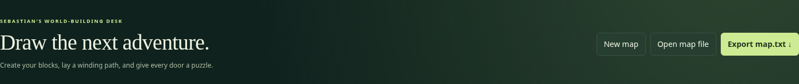

## Choosing the game you are editing

**Game to edit** selects a map collection. Choose Esther’s Enchanted Garden to see Esther’s map directory, or Sebastian’s Workshop Trail to see Sebastian’s directory. The main game retains the existing maps under [Maps] in the master configuration. Changing games asks before replacing unexported work, then opens a fresh editing document. It does not automatically load a numbered map; select one from Open a map afterward, or create a new one.

Map 1 in Esther’s game and Map 1 in Sebastian’s game are independent. Both can define 1/4.1, but those NIDs belong to different game sessions. The map list, image catalog, and Test from Start all follow the selected game. Resume Test keeps its previous game and snapshot, even if you change the editor’s game while paused. Test from Start uses the newly selected game.

Refreshing reads the master catalog and the small game configuration files again. It does not download all map files. Website maps are loaded only when chosen. Configuration/map requests remain on the same origin, bounded by file size and timeout; all configuration values remain data.

## The block library

**Find a block…** searches the block name, NID, and numeric index. Try `key`, `1/4.1`, or `10`. **All four types** filters the palette to one Type. These filters do not remove anything from the map.

Click a palette tile to put that block on your brush. The **On your brush** area shows its name, index, Type, and NID. Double-click a normal palette tile, or click **Edit selected block**, to open its form. **Create a block** starts a new definition. Creating a definition does not automatically place it in the world.

The built-in **777 · Save the princess!** tile can be painted like a block, but it cannot be edited or redefined. It is an immediate ending when approached. A game configuration may give that ending its own title, message, and picture; the palette keeps its familiar princess label. You do not need a custom `[Block.777]` section.

## Drawing and navigation tools

| Tool | How to use it | Allowed examples / shortcut |
| --- | --- | --- |
| Paint | Choose a block; press and drag over squares | B; draw a line of trees |
| Erase | Paint the current default block over cells | E; restore grass |
| Rectangle | Drag between opposite corners of a filled rectangle | R; a 1-column wall or a solid pond |
| Fill | Click a connected area of matching cells | F; turn one grass region into gravel |
| Start | Click the desired starting cell | S; mark (2,2) |
| Pick | Click a placed cell to select its block definition | I; select an interaction tree |
| Pan | Drag to scroll without changing cells | H; explore a large canvas |
| Zoom | Change editor tile display size | 50%, 75%, 100% |

Rectangle fills its whole area; it does not draw only an outline. To make an empty room, draw its four edges separately, or fill a solid wall rectangle and erase its interior. Fill follows matching cells in four directions; it does not cross a different block or connect through a diagonal corner.

Fast Paint drags fill intervening cells, so you do not need to stop at each square. You can also drag a block directly from the palette and drop it onto a cell. Erase does not make a transparent hole: it writes the map’s current default block.

The editor’s 100% display uses 32-pixel cells. At 75% it uses 24 pixels; at 50% it uses 16. Exported coordinates do not change. The game still uses 32×32 cells. Large maps scroll inside their panel rather than becoming a giant web page.

## Exact coordinates and keyboard editing

The coordinate readout shows the cursor’s X, Y, and current block name. The pale outline marks the editing cursor; the S circle marks the player’s start. They may be in different cells.

Enter valid X and Y in the bottom controls, then choose **Go to cell**. This moves the editing cursor and scrolls toward it. **Apply tool here** uses the current tool at that cursor. For Rectangle, the single-cell keyboard action paints one cell; use a drag to define a larger rectangle. Pan has no single-cell painting action.

Click the canvas to focus it. Arrow keys move the editing cursor; Space or Enter applies the tool. Tool shortcuts work when you are not typing into a form. They do not move the game player or change the starting location unless you use Start.

## Undo, redo, and dialog buttons

Undo restores a whole paint stroke, block edit, settings change, fill, or rectangle. Redo restores the undone change. Use the curved arrows, Ctrl/Cmd Z, or Ctrl/Cmd Shift Z; Ctrl/Cmd Y also redoes. A new edit after undo clears the redo branch.

History is limited to at most 40 undo snapshots and a memory budget, so large maps may retain fewer. Opening a different document resets history. Exporting marks the current document as exported but does not clear history. Palette selection, zoom, and local preview pictures are not saved map edits in that history.

Save block and Apply settings accept a form. Cancel, the close button, or Escape dismisses a dialog without accepting unfinished form changes. A block’s duplicate/delete buttons operate on its saved definition, so save unfinished edits before using them.

## Checks, images, and help

**Map checks** lists export-blocking errors and informational notes. Expand it to read them. Notes about another map or a player variable are reminders to check the other file; they are not proof that file exists. Chapter 17 explains common messages.

**Image previews & local artwork** holds the local image picker, URL-preview permission checkbox, and optional preview base URL. These are preview controls, not exported map fields. Chapter 13 explains all of them.

**PDF user guide** opens the complete illustrated PDF in another tab. Keep the docs folder beside editor.html so the link works, including offline when using the downloaded ZIP. **Field guide** opens a short help window. This handbook provides the longer examples and technical connections behind that quick guide.

# 4. Make your first playable map

This practice project is a separate Map 3 called The Key Garden. It uses the starter blocks from New map. Its NIDs differ from those in the bundled Map 1 recipes later in this handbook. Keep the map number in each example: a tutorial key named `3/4.1` is not the sample game key `1/4.1`.

## Step 1 — Choose a small world

On the hosted editor, select the main game first. Choose New map, then Map settings. Set Map number to `3`, Map name to `The Key Garden`, Width to `11`, Height to `9`, Start X to `2`, and Start Y to `2`. Leave the starter grass as the default and brick as the border. Enter `3333 | 3303 | 9999` for viewing windows. Choose Shorthand and Apply settings.

Changing the map number updates the starter NIDs to `3/1.1`, `3/1.2`, `3/2.1`, and `3/2.2`. The starter block indices remain 1, 2, 3, and 4. Notice how map number and block index have different jobs.

## Step 2 — Divide the world with a wall

Select the brick Wall, block 4. Choose Rectangle. Drag from `(6,1)` to `(6,9)`. Because both corners have X=6, the filled rectangle is one column wide. It runs all the way from the bottom to the top and separates the left and right gardens.

There is no way around this wall inside the map. That makes the future door important. If your rectangle is misplaced, Undo restores the whole drag in one step. Try the Go to cell controls to check coordinates carefully.

## Step 3 — Define a key

Choose Create a block. Set Type to Inventory, Name / description to Garden Key, Inventory kind to Item, State to Working or leave its default, and Map image path to `../assets/key.png`. In this clean tutorial, the suggested index should be 5 and NID `3/4.1`. If you created other blocks first, assigned numbers may differ; use the NID displayed in your own key form. Do not try to edit its read-only identifiers.

Save block. Select its tile and paint it at `(3,2)`. The player starts at `(2,2)`, so one step right discovers the key. Pickup choices are automatic; do not add a separate Interaction definition just to pick up an ordinary key.

## Step 4 — Define a door that matches that key

Create another block. Set Type to Interaction and name to Garden Door. Confirm the assigned NID is `3/3.1` in this clean tutorial, and Map image path to `../assets/door.png`. The expected clean-tutorial block index is 6. Set Popup message to “A brass lock blocks the garden path. Which item might fit?”

The new Interaction already has a starter choice. Change Choice text to Unlock the garden door. Set Action to UseInventory and Item selection prompt to Which item will you try? Keep Rules must match at All.

Add a test. Choose Test subject SelectedItem.ID, Comparison Equal, and Required value `3/4.1`. If your key has a different NID, use that exact full NID instead. Leave the quantity qualifier out; SelectedItem.ID does not count inventory.

On PASS, enter “The key fits! The door folds into a paper bird and flies away.” Leave Replacement NID blank so the cell becomes the map default grass. On FAIL, enter “That item does not fit. You keep it and step back.” Leave the other outcome fields blank. Save block.

## Step 5 — Place the door and the ending

Paint Garden Door at `(6,4)`, replacing that brick cell. Select built-in 777 and place it at `(9,6)`. Do not create a new definition for 777. Keep the left garden clear enough to reach the key and the door.

The door does not have to be called an enemy. It simply uses the same flexible choice-and-test system as any other Interaction. A successful key match consumes one regular key, replaces the door with grass, and allows entry because the replacement is Move.

## Step 6 — Export and connect it to the game

If editor.html and the full game are on the same HTTP(S) website, you can preview this new map immediately with Test from Start, even before adding Map.3 to the master directory. See Chapter 17 for pause/resume. Export and connect the map when you are ready to publish it.

Read Map checks and fix errors. Export downloads `map-3.txt`. Put it in your game’s `maps/` folder. In `main-config.txt`, add `Map.3: maps/map-3.txt` under [Maps]. To start directly in this tutorial, set `StartMap: 3` under [Game]. Keep the other master settings and image entries.

The master file is outside the editor; use a plain-text editor for that small change. If you are working inside WordPress uploads, use the real uploaded map URL rather than assuming the filename stays unchanged.

## Step 7 — Play both the wrong path and the right path

Run the game through HTTP(S). First try the door without a key. You should not be able to enter. Then start a fresh adventure, collect the key, approach the door, choose the key, and check that the door becomes grass. Reach the princess to finish.

If you need a wrong-item test, add a regular bomb item with a different NID and choose it at the door. With Take additional items blank on FAIL, the attempt must preserve that bomb and the player’s position. Make a note of the expected result before you test.

> DESIGN CHALLENGE: Add a second door with the same key rule. How many keys must you provide? If a successful use consumes a key, one key will not open two separate doors unless another reward supplies a replacement key.

# 5. Every Map settings field

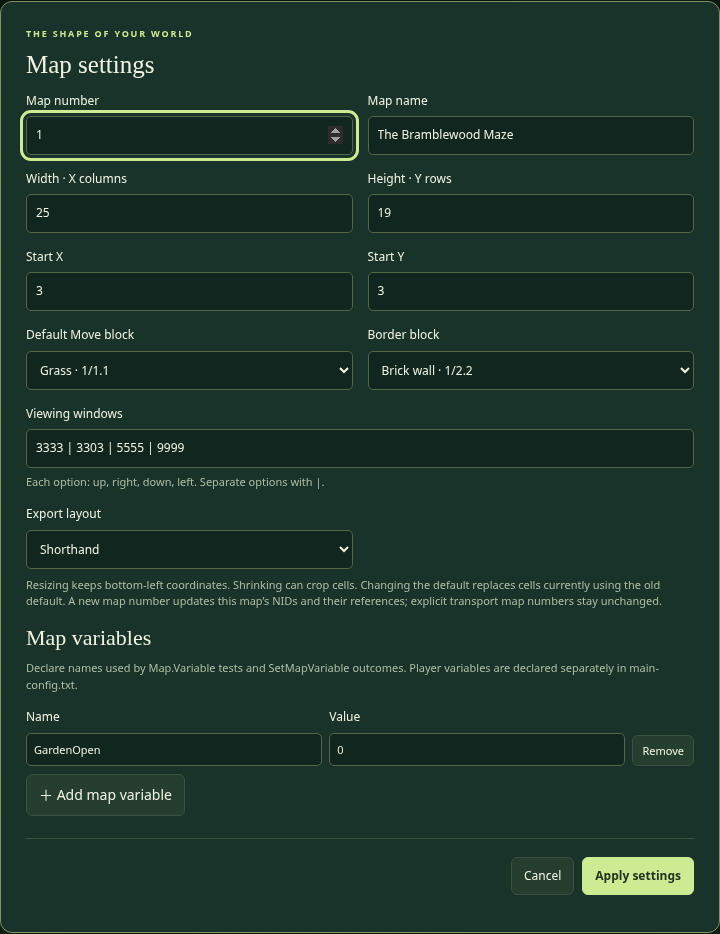

## Map number — ID

**What it does:** Gives this map its identity. **Valid setting:** A positive whole number, such as 1, 2, or 3. It must match the `Map.N` entry that loads it in the main configuration. It is not the width, file line number, or block index.

**Example:** Map number 3 exports as `map-3.txt`, and its local block NIDs begin with `3/`. The master directory might contain `Map.3: maps/map-3.txt`.

**Creative use:** Give a forest, cave, and castle different map numbers and connect them with transport Interactions. The numbering is your filing system; it does not force a travel order.

**Connections:** Applying a new number rewrites this editor document’s local NIDs and their structured references. It does not edit other map files, the main configuration, picture URLs, message text, or explicit transport map numbers. Review those separately. Reusing a number for a different published map changes what references to that number mean.

## Map name — Name

**What it does:** Sets the player-facing map title. **Valid setting:** A readable, nonempty name; the form allows up to 160 characters. Use ordinary text, not HTML styling.

**Example:** The Key Garden, The Bramblewood Maze, or Grandma Gnome’s Cellar. A name can contain spaces and punctuation.

**Creative use:** A title sets a mood before a puzzle begins. “The Forgotten Orchard” suggests something different from “The Very Suspicious Orchard.” It can also give a fair clue.

**Connections:** The name appears in the editor and game, but changing it does not change the map number, NIDs, filename, or transport targets. The game finds a map through its number and URL, not by matching the name.

## Width — X columns

**What it does:** Sets how many columns exist. **Valid setting:** A whole number from 1 through 100. The rightmost valid X equals this width.

**Example:** Width 25 allows X=1 through X=25. Combined with Height 19, the file writes `Dimensions: 25x19`.

**Creative use:** A narrow map can feel like a bridge or tunnel. A wide map can support several routes or hidden shortcuts. Begin small; a carefully designed 11×9 puzzle is better than an empty 100×100 world.

**Connections:** Enlarging fills new columns with the current default. Shrinking crops cells beyond the new right edge after a confirmation. The player start must remain in range; adjust Start X before applying if necessary. Other map files with transports into cropped coordinates need review too.

## Height — Y rows

**What it does:** Sets how many rows exist. **Valid setting:** A whole number from 1 through 100. The topmost valid Y equals this height.

**Example:** Height 19 allows Y=1 through Y=19. In a longhand file, the first data row is Y=19 and the last is Y=1.

**Creative use:** Make a tall tower-shaped journey or a long northbound trail. The screen still shows only the selected viewing window, so a tall map can unfold gradually.

**Connections:** Resizing preserves bottom-left coordinates. Increasing height adds rows at the top; it does not shift existing Y values. Shrinking removes upper rows, so check starts, placed rewards, and transport arrivals. The editor asks before cropping; Undo can restore it while that history is still available.

## Start X and Start Y — StartingLocation

**What they do:** Choose the player’s arrival when starting this map normally or using a map-only transport. **Valid settings:** Whole coordinates inside the dimensions. X must be 1 through Width; Y must be 1 through Height.

**Example:** Start X=3 and Start Y=3 become `StartingLocation: (3,3)`. The Start tool writes this same setting by clicking a cell.

**Creative use:** Start beside a sign, in a safe clearing, or inside a mysterious enclosure. A beginning that offers one visible clue teaches the player what to try first.

**Connections:** The start is also the fallback for bad transport coordinates. Invalid starting coordinates prevent loading, because the game needs a valid fallback. The start marker does not replace its underlying block and does not trigger that cell. Starting on a Wall is technically possible, but a normal Move cell is usually clearer and safer for players.

## Default Move block — DefaultBlock

**What it does:** Chooses the basic material that fills the world. **Valid setting:** The full NID of a Move definition in this map. The dropdown offers local Move blocks only.

**Example:** `1/1.1` is grass in the bundled map. A cave map could define a different Move block as its default floor.

**Creative use:** Switching the default floor changes the setting of the whole world. A sandy desert, snowy field, or stone dungeon can use the same puzzle mechanics with new art.

**Connections:** The game fills the grid with this block before reading placements. Erase uses it. Ordinary inventory pickup uses it as the replacement. A successful Interaction with blank replacement uses it. Changing it in the editor changes cells currently using the old default, including cells you deliberately painted with that old block. It must be Move so successful pickup does not leave an unintended obstacle.

## Border block — BorderBlock

**What it does:** Chooses the picture drawn outside the valid world when a viewing window reaches past an edge. **Valid setting:** A full NID defined in this map. A Wall is the usual choice, though the reader does not require that Type.

**Example:** `1/2.2` draws brick beyond the sample map. At player coordinate `(1,1)`, cells that would be X=0 or Y=0 use this border picture.

**Creative use:** Tree borders suggest a forest; dark stone suggests a dungeon. The border can make a tiny map feel enclosed without writing out invisible coordinates.

**Connections:** This is a drawing setting, not a row of actual placed walls. It does not paint the edge cells of your map. Place real Wall blocks inside valid coordinates when a route needs them. Walking outside the dimensions is blocked regardless of what border picture you selected. BorderBlock must remain defined, so the editor protects it from deletion.

## Viewing windows — ViewWindow

**What it does:** Lists the viewing options available to the player. **Valid setting:** One or more four-digit codes, with each digit 0–9, separated by ` | `. Read each code in this order: up, right, down, left.

**Examples:** `3333` shows three cells in every direction plus the player: 7×7. `3303` shows three up, three right, zero down, three left: 7×4, with the player on its bottom row. `9999` shows 19×19. `0000` shows only the player’s cell.

**Creative use:** A small view makes exploration feel mysterious. An uneven view can emphasize the path ahead. Let players choose several views when a larger overview helps them reason through a maze.

**Connections:** The first option is the default on entering a map. Display width is left + right + 1; height is up + down + 1. These are viewing distances, not map dimensions, zoom percentages, or pixel sizes. The largest four-single-digit window is 19×19 even when the world is 100×100.

## Export layout — Format

**What it does:** Chooses how the cell layout is written in the downloaded file. **Valid settings:** Shorthand or Longhand, with those exact spellings in text.

**Example:** A run of fifteen tree blocks might be `(1,20)3(15)` in Shorthand. Longhand writes every cell of every row, using repeats where helpful. Both formats represent the same finished grid.

**Creative use:** Shorthand is convenient when most of a world is the default floor. Longhand can be easier when comparing a complete paper row with a complete text row.

**Connections:** Changing format does not change placement coordinates or game behavior. Export rebuilds the layout from the edited grid; it does not preserve original shorthand entry order. Longhand starts with the highest Y row. See Chapter 15 before hand-editing layout text.

## Map variables — Name and Value

**What they do:** Declare a named memory value belonging to this map. Add a row, enter Name and Value, and Apply settings. **Valid name:** Start with a letter; continue with letters, digits, or underscores. **Valid value:** A nonempty single-line number or text value. Names are case-sensitive and cannot repeat.

**Examples:** `GateOpen: 0`, `RiddleAnswer: moon`, or `BridgeReady: No`. `GateOpen` is different from `gateopen`. Do not put spaces in a variable name; use `BridgeReady` or `Bridge_Ready`.

**Creative use:** A 0/1 variable is a handy memory flag. Let a switch set BridgeReady to 1, then let a different Interaction test it. This makes distant parts of a puzzle cooperate.

**Connections:** Tests use `Map.Variable.BridgeReady`; outcomes use `SetMapVariable.BridgeReady`. The declaration creates the starting value, the test reads it, and an outcome changes it. The editor catches undeclared local variables. Player variables are declared in the main configuration instead. Variables are not arithmetic formulas: setting 1 means assign 1, not add 1.

# 6. Every shared block field

Create or select a block, then open its form. Some fields appear only for the relevant Type. The editor manages the index and NID automatically. Both fields are read-only, visible, selectable, and copyable. Read them when writing a rule that refers to the block.

## Block index

**What it does:** Gives a definition its local number in the map layout. **Valid setting:** A positive whole number assigned by the editor; 777 is reserved. You cannot type into this field. Imported numbers are preserved.

**Example:** [Block.10] is placed by (8,5)10. Another map may have a different Block 10. Creating or duplicating a block receives a fresh number; deleting Block 5 does not renumber Block 6.

**Creative use:** Give objects meaningful descriptions and let the app handle their filing numbers. Copy the index when comparing an exported row with graph paper.

**Connections:** [EditorIDs] stores the next unused numbers. Keep it in exported files. Numbers stay reserved after deletion and undo, and exports retain those reservations across reopening. Gaps are intentional. Text / INI remains an advanced editor: manually changing an index there requires correcting its placements, and validation still checks conflicts.

## Type

**What it does:** Selects the main behavior. **Valid settings:** Move, Wall, Interaction, or Inventory. The matching NID category must be 1, 2, 3, or 4 respectively.

**Example:** A removable tree is Interaction even if its picture is exactly the ordinary Wall tree. A chest is usually Interaction; the sword inside it is Inventory.

**Creative use:** Reusing a picture with a different Type creates secrets. A “door” picture can be Move for a permanently open doorway, or Interaction for a puzzle that blocks passage.

**Connections:** Changing Type changes which form fields are relevant, assigns a matching-category NID, and may remove interaction choices after confirmation. A default block cannot become a Wall or Interaction while it is still the map default. Read the NID again after changing Type so references are intentional.

## Full NID

**What it does:** Names the definition for tests, rewards, replacements, and cross-map inventory. **Valid setting:** `map/category.unique`, such as `1/4.1`. All pieces are positive whole-number labels; use category 1–4. The originating map prefix must match this map for a local definition. Each definition needs a distinct NID.

**Example:** `1/3.3` identifies the sample door, while `1/4.1` identifies its matching regular key. Their matching rule, not similar numbers, connects them.

**Creative use:** Different key NIDs let you invent brass, silver, and master locks. Two sword NIDs can have different power or state, even if they share a picture.

**Connections:** This field is read-only. Changing Type or the map number updates recognized NID references inside this map, including SelectionItems. Returning to the original Type before saving restores the original NID. It does not edit another map that accepts the old item, or rewrite a name tag mentioned in ordinary message text. Always check the other files when changing a shared item identity. Never shorten a reference to just `4.1`.

## Name / description — Description

**What it does:** Gives the block or item a readable name. **Valid setting:** Nonempty plain text, up to 160 characters in the form.

**Examples:** Trail Boots, Standard Door, Sparkling Chest, or The Pig of the North Path. Be clear enough that the player can recognize items in a selection list.

**Creative use:** Names can give clues without explaining the entire answer. “Hollow Tree” hints more than “Tree”; use “Tree” if you want the clue to appear only after an interaction attempt.

**Connections:** The game uses this name for titles, inventory labels, and message placeholders such as `{Target.Name}` and `{SelectedItem.Name}`. Changing a name does not change the NID or the block’s rules. The name is not a function name or a command.

## Map image path — MapImage

**What it does:** Chooses the picture displayed for the block’s cell. **Valid setting:** A relative picture path, @Name image catalog alias, or HTTP(S) URL; use HTTPS for public hosting. This field is required. Script, data, and local `file:` URLs are not exportable picture paths.

**Examples:** `../assets/tree.png` from a map in the maps folder, or `https://your-site.example/uploads/tree.png` after uploading a picture.

**Creative use:** Change art to turn a forest puzzle into an ice-cave puzzle without changing the rule system. An interaction tree can deliberately share its image with a Wall tree.

**Connections:** The game resolves relative paths from the map file’s URL, not the editor’s location or the WordPress page. Standard cells display at 32×32 pixels. An editor preview does not prove a picture has been uploaded. Keep the actual image file separate and publish it at the path you wrote.

## Popup image path — InteractionImage

**What it does:** Chooses the larger picture in an interaction or pickup popup. **Valid setting:** A picture path/URL like MapImage, or blank to reuse MapImage.

**Example:** Keep `../assets/pig.png` for the tile but use `../assets/pig-portrait.png` for a more expressive popup. A blank field is perfectly fine for the first draft.

**Creative use:** A small chest tile can open into a detailed treasure drawing, or a mysterious wall symbol can have a readable close-up.

**Connections:** This is still a separate image file; it is not embedded in map export. It does not change the block’s Type or rules. The editor’s local preview tools focus on palette/canvas map images; they are not a complete popup-art playtest. Check the actual game popup after publishing the image.

## Popup message — Message

**What it does:** Describes what the player notices before choosing an action. **Valid setting:** Optional plain text. The form accepts wrapped typing and turns entered line breaks into spaces when saving; the specification stores one physical line per value.

**Example:** “A wooden door blocks the trail. A brass keyhole waits below its handle.” This describes the situation; the later PASS/FAIL message explains the result.

**Creative use:** Teach through clues: “Carrying boots is only half the job” hints that the player must wear them. A character can speak with humor, like an old text adventure.

**Connections:** This field does not run tests or substitute outcome placeholders in the initial description. Use the exact supported placeholders in an outcome Message instead. HTML tags do not style it; they appear as text. Cancel text and choice labels are separate fields.

## Cancel text — CancelActionText

**What it does:** Labels the interaction’s safe way to leave. **Valid setting:** Optional plain text; blank defaults to Leave.

**Examples:** Back away quietly, Leave the chest alone, or Think about it. The label can fit the character or mood.

**Creative use:** A funny cancel line adds personality without changing the puzzle. “Politely retreat” fits a proud pig; “Keep my eyebrows” fits an uncertain bomb experiment.

**Connections:** Cancel is automatically provided for normal Interactions and does not run PASS or FAIL outcomes. It does not consume an item or enter the cell. Do not create an automatic-PASS choice called Run away and assume it is cancel; a normal choice still applies its outcomes and default replacement.

## Required power — RequiredPower

**What it does:** Stores a nonnegative whole-number strength on an Interaction. **Valid setting:** 0 or a larger whole number; blank defaults to 0.

**Example:** A pig has Required power 6. An Attack choice tests `SelectedItem.Power | GreaterThan | Target.RequiredPower`. A power-8 sword passes; power 2 fails; power 6 also fails because GreaterThan is strict.

**Creative use:** Different monsters can require different weapons. The names can be playful: a rusted gate or stubborn rock can use strength tests too, if you present an Attack choice.

**Connections:** RequiredPower does nothing by itself. You must add a rule that reads it. It is not player health, enemy combat HP, random damage, or a number that decreases each turn. Use GreaterOrEqual if equal strength should succeed. This version has puzzle checks, not repeated damage battles.

# 7. Inventory, weapons, and wearables

Inventory is a block Type. Item, Weapon, and Wearable are kinds within that Type. They affect how the player can select or equip an owned object. All remain identified by full NID across maps.

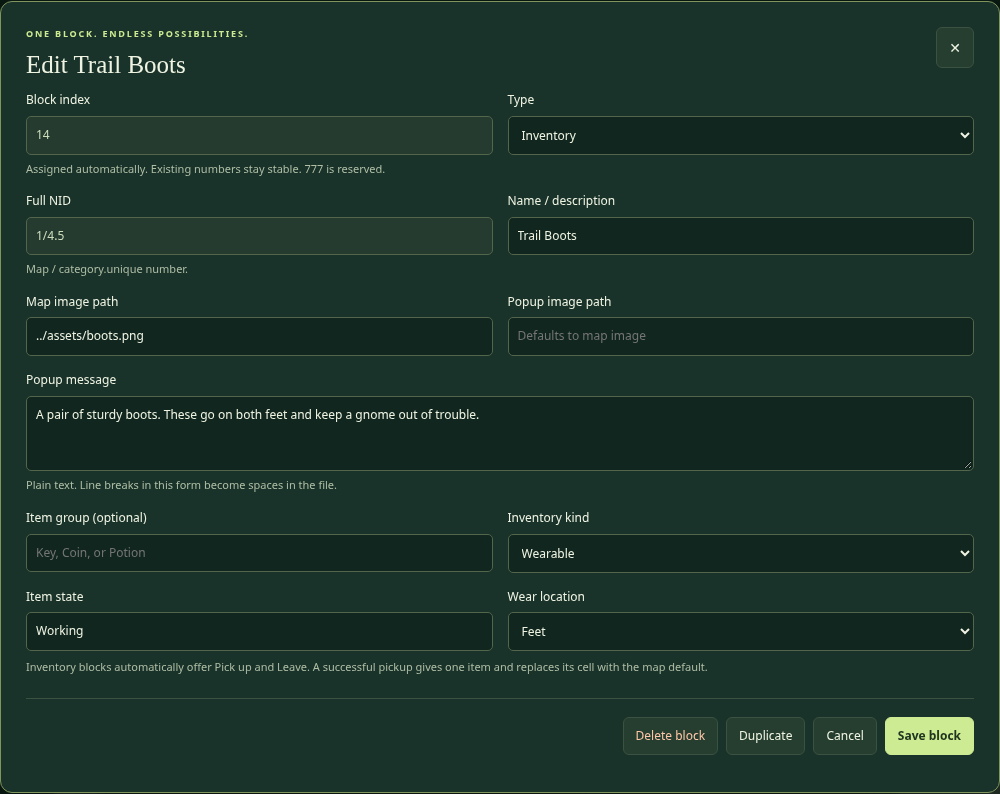

## Inventory kind — ItemKind

**What it does:** Chooses an inventory object’s role. **Valid settings:** Item, Weapon, or Wearable. Every Inventory definition needs one.

**Examples:** A key or bomb is Item; a sword is Weapon; boots are Wearable. In the current game, UseInventory offers Items, Attack offers wielded Weapons, and the pack provides Wear/Wield controls.

**Creative use:** Design a flute as an Item used at a musical gate, a staff as a Weapon with puzzle power, or a disguise as a Wearable that changes which character admits you.

**Connections:** A successfully selected regular Item disappears once on PASS. Weapons and clothing are reusable. Simply checking whether an object is owned or worn does not consume it. A Weapon is not offered in UseInventory, so use Attack for weapon selection. A potion Item needs an Interaction that offers its use; the first draft has no separate free-use potion button in the pack.

## Item state — State

**What it does:** Gives new instances of this inventory definition a condition label. **Valid setting:** Optional nonempty text, with Working as the default. Use exact capitalization consistently.

**Examples:** Working, Broken, Cursed, or Polished. These are labels you can test; they are not built-in scripts.

**Creative use:** Offer a strong but Cursed sword and a weaker Working one. A particular puzzle could require the unusual sword’s ID and state. A Broken relic can be a story object rather than a useful wearable.

**Connections:** Equipment.Worn and Equipment.Wielded list only Working equipped items. Attack selection can still offer an equipped nonworking weapon, so add a SelectedItem.State Equal Working rule when that matters. The state label alone does not automatically change weapon power or curse the player. This editor does not currently provide an outcome to change an individual item’s State; make a separate definition for a different condition if needed.

## Weapon power — Power

**What it does:** Gives a Weapon its puzzle strength. **Valid setting:** A nonnegative whole number; blank defaults to 0.

**Example:** Bramble Sword has Power 8; Wooden Dagger has Power 2. The selected weapon’s value is read by SelectedItem.Power.

**Creative use:** Hide a stronger weapon behind an optional clue. A short sword might solve early obstacles while a two-handed giant sword opens a later route. Power is only one possible condition; an enemy can also require a specific NID or a player state.

**Connections:** Power is not added to player HP, and two equipped weapons do not automatically add their power together. Attack asks which single wielded weapon to use. Compare that selected weapon against Target.RequiredPower or an explicit number. Weapons do not disappear after a successful match.

## Hands required — Hands

**What it does:** Chooses how many weapon slots the Weapon occupies. **Valid settings:** One hand (1) or Both hands (2). The default is 1.

**Example:** A dagger can be wielded in either the left or right hand. A giant sword occupies both. Equipping the giant sword puts away weapons previously wielded in either hand.

**Creative use:** Make equipment choices feel meaningful without a battle simulator. A player might need to put away a large weapon before selecting a different one. The current rule list checks wielded NIDs, not a chosen left/right slot directly.

**Connections:** Weapon slots are separate from clothing slots. Gloves on both hands do not come off when a sword is wielded. Put-away weapons stay owned in inventory. One hand does not mean the object is automatically wielded when collected; the player must choose Wield in the pack.

## Wear location — WearLocation

**What it does:** Chooses which clothing slot or pair of slots a Wearable occupies. **Valid setting:** One exact location from the following table. Wearables need a valid location; choose it in the dropdown.

| Location | Slots occupied | Allowed examples |
| --- | --- | --- |
| Head | Head | Helmet, thinking cap |
| Torso | Torso | Coat, disguise shirt |
| Arms | Left and right arm | Paired arm guards |
| LeftArm | Left arm | Left-arm shield sleeve |
| RightArm | Right arm | Right-arm guard |
| Legs | Left and right leg | Trousers, paired leg armor |
| LeftLeg | Left leg | Left-leg brace |
| RightLeg | Right leg | Right-leg guard |
| Feet | Left and right foot | A pair of boots |
| LeftFoot | Left foot | A single kicking shoe |
| RightFoot | Right foot | A single right sandal |
| Hands | Left and right clothing-hand slot | A pair of gloves |
| LeftHand | Left clothing-hand slot | One left glove |
| RightHand | Right clothing-hand slot | One right glove |

**Creative use:** A mud crossing can require boots actually worn, not merely found. A single kicking shoe and a pair of boots can compete for foot slots. A disguise can occupy Torso while boots occupy Feet.

**Connections:** Overlapping clothing replaces the whole prior item and returns it to the pack. Putting on Feet boots removes a LeftFoot shoe. Putting a LeftFoot shoe on while wearing Feet boots removes the whole pair, rather than leaving a mysterious half-pair. Torso, arms, legs, and feet are separate groups; do not assume more realistic body overlap than this listed system. The current tests check a worn item’s NID, not its location directly.

## Inventory is ownership; equipment is an extra relationship

An item can be both in inventory and worn/wielded. The pack marks the equipment slots while retaining ownership. Inventory.Quantity counts all owned instances with that NID, including equipped ones. Equipment.Worn and Equipment.Wielded answer the narrower question about working equipped items.

If you place two bomb cells, collecting both gives two instances. Using one successfully consumes one. If you want two differently behaving bombs, make two definitions with different NIDs. Sharing a definition does not link the collection state of their separate map placements.

## Item group — ItemGroup

**What it does:** Gives an Inventory definition a simple classification that interaction choices can use to shorten their lists. **Valid setting:** Optional single label starting with a letter, followed by letters, digits, underscores, or hyphens; at most 64 characters. Labels are case-sensitive.

**Examples:** Key, Coin, Potion, Garden_Key. Give both the standard key and master key ItemGroup: Key. A door choice can then use SelectionGroup: Key.

**Creative use:** A merchant can offer to trade only Coins; a fountain can offer to use only Potions. This controls which items appear, while tests still decide whether the selected object works.

**Connections:** An item has one group. A group is not its ItemKind, power, state, or NID. UseInventory still offers only regular Items, and Attack only currently wielded Weapons. Group labels do not bypass those action restrictions.

## The compact bag: groups, counts, equipment, and discarding

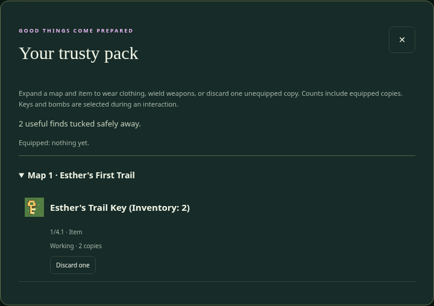

Inventory opens from the map toolbar. The bag shows an Equipped summary and collapsible source-map groups. Inside them, one expandable row represents each full NID. Inventory: 8 means eight owned copies, including equipped ones. A single copy has no quantity suffix. Equipped copies receive an equipped indicator.

Expand a row for state-specific details and Wear, Wield, Put away, or Discard one. Copies remain separate in memory. A Working and Cursed version may share a row, but their expanded actions and interaction selection distinguish those conditions. A two-handed weapon remains one owned copy, not two.

Discard one asks for confirmation naming the object. Canceling keeps everything. Confirming removes one unequipped copy permanently for that run; it does not paint a new object on the map or restore the pickup cell. Put an equipped item away before discarding it. Discarding a needed last key can make a puzzle impossible, so designers should test that consequence or provide a spare-item chest. Restarting a game starts fresh; reentering a map keeps the current run’s changes.

The bag scrolls within a bounded window, with its Close button kept at the top. Collapsing a map group hides its rows without removing anything. Counts still match Inventory.Quantity tests; display stacking never combines equipment slots or changes puzzle results.

# 8. Every choice field and control

An Interaction needs at least one choice. Each choice gets its own action, tests, and two possible outcomes. The game displays the block’s title, description and picture, then offers these choices and the separate cancel button.

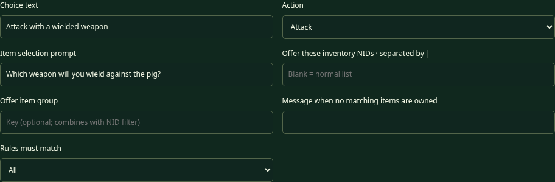

## Choice text — Text

**What it does:** Labels the choice button. **Valid setting:** Nonempty plain text. Write what the player is deciding to do.

**Examples:** Unlock the door, Try to cross, Attack with a wielded weapon, or Open the chest.

**Creative use:** Give a character several understandable approaches: “Offer an item” could use UseInventory, while “Ask about the bridge” could use Attempt and test a progress flag.

**Connections:** The label does not select the action automatically. A button called Attack still needs Action=Attack. A button called Leave is not automatically cancel. Use Cancel text for a true no-effect exit, or carefully define a normal choice’s outcomes if it should have story consequences.

## Action

**What it does:** Decides whether the game needs the player to select an object before testing. **Valid settings:** Attempt, UseInventory, or Attack.

**Attempt** selects nothing further. Use it for crossing mud based on equipment, reading a sign, opening a free chest, or testing a variable. **UseInventory** asks the player to choose a regular Item from the pack. **Attack** asks for one currently wielded Weapon.

**Creative use:** “Offer a shiny object” and “Unlock the door” can both use UseInventory with different matching rules and story text. You do not need new JavaScript actions for each verb in your story.

**Connections:** SelectedItem tests need an action that actually selects an item. Attempt does not automatically search for a key or sword. If no eligible item is available, the game gives guidance and leaves the interaction open without resolving PASS or FAIL. The built-in PickUp behavior belongs to Inventory blocks and is not an extra action you select here.

## Item selection prompt — SelectionPrompt

**What it does:** Asks the player which item/weapon to choose after UseInventory or Attack. **Valid setting:** Optional plain text. Blank uses a general “Choose an item” prompt.

**Examples:** Which key will you try? What will you offer the bridge keeper? Which wielded weapon will you use?

**Creative use:** A prompt can make the second step part of a conversation or clue. Be clear enough that the player knows whether they are choosing a packed item or a weapon in hand.

**Connections:** Attempt has no item-selection step, so this prompt does not make Attempt select something. The eligible list is controlled by Action and ItemKind/equipment, not by the words in this prompt. Prompts are plain text; outcome placeholders are intended for outcome messages.

## Rules must match — TestsMatch

**What it does:** Combines that choice’s tests. **Valid settings:** All or Any. All is the default.

**Example of All:** The selected object must be the master key AND a map variable must say the power is on. **Example of Any:** A crossing passes if the player wears the named boots OR has the Blessed player state.

**Creative use:** All builds a puzzle chain; Any builds alternative solutions. Alternative routes can make a maze more forgiving and fun to replay.

**Connections:** No tests means automatic PASS, even when Any is selected. Every rule still needs to be valid; Any does not hide a misspelled variable behind another successful rule. This version has one flat group per choice, not nested groups such as “A and (B or C).” Separate choices are often the clearest way to offer complicated alternatives.

## Add, remove, and reorder choices

Add choice creates another independent choice card. The up and down arrows change presentation order; Remove choice deletes that card when the block is saved. The editor numbers the saved choices from 1 in their displayed order.

Removing every choice from an Interaction makes it invalid. A Move or Wall does not need choices. Changing an existing Interaction into another Type can remove its saved choices after confirmation. Save carefully, then Export; Undo can restore a saved change while it remains in history.

Each choice card has its own tests and outcomes. A second button does not borrow the first button’s key rule. For example, an “Inspect the door” Attempt with no tests will PASS; give it a same-door replacement if the inspection should leave the door in place and keep the player beside it.

## Offer these inventory NIDs — SelectionItems

**What it does:** Optionally limits the second-step selection for one choice to listed, owned full NIDs. **Valid setting:** A pipe-separated list of full NIDs; blank uses the action’s normal eligible items. Each referenced definition must exist in this game, even when it originates on another map.

**Example:** SelectionItems: 1/4.1 | 1/4.4 offers standard and master keys. A separate SelectedItem.ID Equal 1/4.1 test accepts only the standard key. The master key can still be a wrong guess. Identical copies with the same condition display once with a quantity; choosing the stack selects one actual copy.

**Creative use:** Remove bombs, coins, and potions from a door’s selection list while retaining the puzzle of which key fits. Listing only the correct key gives a more guided puzzle.

**Connections:** This is a choice field, not a whole-block field. Another choice on the same object may offer a different list. The engine enforces the filter as well as the interface. Filtering does not grant PASS, spend an item, change a cell, or replace the choice’s tests. UseInventory cannot offer Weapons/Wearables; Attack cannot offer an unwielded weapon.

## Offer item group — SelectionGroup

**Valid setting:** Optional ItemGroup label, using the same spelling and case as the Inventory definitions. **Example:** Key offers every owned, action-eligible Key item. Blank applies no group filter.

**Creative use:** Add another kind of key later without updating every door’s candidate list. If SelectionItems and SelectionGroup are both filled, an item must satisfy both filters. They are an intersection, not alternatives.

**Connections:** Merely finding the right group does not prove success. Keep the relevant tests for the exact key, working state, weapon power, worn boots, or puzzle variables.

## Message when no matching items are owned — NoSelectionMessage

**Valid setting:** Optional plain text. **Example:** You have no keys to try here. Blank uses the game’s standard item/weapon guidance.

**Creative use:** Hint where a player should explore next. An empty selection keeps the interaction open with its Leave choice. It runs neither PASS nor FAIL, so it never applies a failure penalty merely because the bag has no suitable object.

# 9. Every rule field and test subject

A rule is a question with parts: **Test subject | Comparison | Required value**. Inventory.Quantity has one extra part identifying which item to count. The form handles the separators for you. You only need the raw syntax when reading or editing Text / INI.

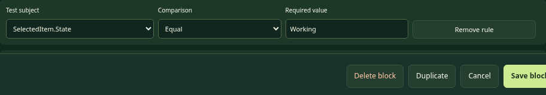

## Test subject

This chooses what the game reads. Use a selected-item subject for something the player chose now, an inventory subject for ownership, an equipment subject for wearing/wielding, and a variable/state subject for remembered progress. The fixed subject list prevents map files from running arbitrary scripts.

### SelectedItem.ID

**Valid value:** The full NID of an Inventory definition. **Example:** SelectedItem.ID Equal `1/4.1` accepts the standard key selected for a door. UseInventory or Attack must supply the selection.

**Creative idea:** A flute opens a musical gate only when the player actually offers that flute. Owning it somewhere in the pack is not the same as choosing it. **Connection:** A successful selected regular Item is consumed automatically; the test itself does not remove anything before success. It is possible to test a Weapon NID with Attack because weapons are Inventory definitions too.

### SelectedItem.State

**Valid value:** Exact item-state text, such as Working, Broken, or Cursed. **Example:** SelectedItem.State Equal Working ensures the selected sword is in the intended condition.

**Creative idea:** A haunted gate might require a specifically Cursed relic. **Connection:** This reads the item’s condition, not the player’s list of states. AddState Cursed changes Player.State, not SelectedItem.State. There is no current generic outcome that repairs an individual item by changing its stored State.

### SelectedItem.Power

**Valid value:** A number or the special right-side reference Target.RequiredPower. **Example:** SelectedItem.Power GreaterThan Target.RequiredPower compares a selected weapon’s power to that obstacle’s strength.

**Creative idea:** Reuse one Attack-choice pattern for several obstacles with different Required power values. **Connection:** The power comes from the single selected weapon definition. It does not sum both hands, count swords, or add player health. Use Attack so a wielded weapon is selected.

### Target.RequiredPower

**Valid value:** A number for comparison; this subject reads the current obstacle’s Required power. **Example:** Target.RequiredPower LessThan 10 can make a choice work only on weaker obstacles.

**Creative idea:** A “push it aside” choice could be allowed only for low-strength obstacles, while a separate Attack choice uses a weapon. **Connection:** Target means the block being approached, not the player or a destination after transport. Setting RequiredPower without a rule does not create an automatic strength check.

### Inventory.Quantity

**Valid value:** A numeric count to compare, plus a full Inventory NID in Count this item NID. **Example:** Inventory.Quantity GreaterOrEqual 2, counting `1/4.1`, requires at least two standard keys.

**Creative idea:** A toll chest can require two tokens, or a character can recognize someone who carries three feathers. **Connection:** This counts all owned copies, including worn/wielded items. Checking quantity does not consume them. If an Attempt should take two regular tokens on PASS, list their NID twice in Take additional items. If UseInventory already consumes the selected token, list only the additional copy there.

### Equipment.Worn

**Valid comparison/value:** Contains or NotContains with a full Inventory NID that represents the desired wearable. **Example:** Equipment.Worn Contains `1/4.5` checks the sample boots.

**Creative idea:** Mud needs boots, a snowy ridge needs a coat, or a palace guard recognizes a disguise. **Connection:** Carrying the item is not enough. The player must equip it with Wear. The current equipment lists include only items whose State is Working. This subject tests NIDs, not a raw location such as Feet; the item’s WearLocation handles where it fits.

### Equipment.Wielded

**Valid comparison/value:** Contains or NotContains with a full weapon NID. **Example:** Equipment.Wielded Contains `1/4.2` checks whether the sample sword is working and in a hand.

**Creative idea:** A guardian might allow passage when a particular ceremonial staff is displayed, even with Action=Attempt. **Connection:** That kind of check does not choose a specific weapon for an Attack or consume it. Attack selection and SelectedItem.Power are different tools. The subject does not directly say left hand or right hand.

### Player.State

**Valid comparison/value:** Contains or NotContains with a text state label. **Example:** Player.State Contains Blessed, or Player.State NotContains Muddy.

**Creative idea:** A shrine adds Blessed; a moon door later tests it. A wash station removes Muddy. **Connection:** States are a collection, not a single overwritten status. Several may coexist. These labels have no automatic movement, health, or combat effect unless your rules test them. AddState and RemoveState outcomes change this collection.

### Player.Variable. plus Variable name

**Valid name/value:** A declared player-variable name and a matching numeric/text comparison. **Example:** Choose Player.Variable., enter BadgeCount as Variable name, and test Equal 1. The text form becomes Player.Variable.BadgeCount.

**Creative idea:** Track a story milestone that should be remembered on every map. **Connection:** Declare BadgeCount in [PlayerVariables] of the main configuration before play. Map Studio cannot verify that other file and gives a reminder note. Use SetPlayerVariable.BadgeCount in an outcome to assign a new value. It is not an automatic counter or a value shared between different players’ browser tabs.

### Map.Variable. plus Variable name

**Valid name/value:** A variable declared in this map’s Map settings. **Example:** Choose Map.Variable., enter BridgeReady, and test Equal 1.

**Creative idea:** A lever remembers that a bridge puzzle has been solved elsewhere in the same map. **Connection:** SetMapVariable.BridgeReady changes that local value. It does not repaint the distant bridge cell automatically; that cell needs its own Interaction that checks the flag. Returning to this map keeps the value during the current game session.

## Comparison

| Setting | What the question means | Allowed examples |
| --- | --- | --- |
| Equal | Exactly the same scalar value | SelectedItem.ID equals 1/4.1 |
| NotEqual | Different scalar values | SelectedItem.State is not Cursed |
| GreaterThan | A number is strictly larger | Power 8 is greater than 6; 6 is not |
| LessThan | A number is strictly smaller | Strength 4 is less than 10 |
| GreaterOrEqual | Larger or equal | Power 6 passes a requirement of 6 |
| LessOrEqual | Smaller or equal | Quantity 2 is at most 2 |
| Contains | A collection includes the value | Equipment.Worn contains 1/4.5 |
| NotContains | A collection does not include the value | Player.State does not contain Muddy |

Use Contains/NotContains only for Equipment.Worn, Equipment.Wielded, and Player.State. Do not ask whether the whole equipment collection is Equal to one item. Use scalar comparisons for a number, NID, or single text value. Numeric comparisons need numbers, not a word such as strong.

## Required value

Enter the literal value the rule should match: an NID, state, number, or variable value. Do not add quotation marks unless quotation marks are truly part of the text you want to compare. Matching is case-sensitive: Working and working are different.

Numeric-looking values are interpreted as numbers. `8` is a number; `1/4.1` is a text label. Choose word-like labels for player/item states instead of numeric labels to avoid confusing text and numeric comparisons.

The only computed right-side reference currently supported is `Target.RequiredPower`. Writing `Power + 2`, a JavaScript expression, or `Player.Variable.OtherValue` on the right does not perform a calculation or read a second variable. Use an explicit number or redesign the puzzle as separate choices.

## Count this item NID and Variable name

Count this item NID appears for Inventory.Quantity and must contain the exact Inventory NID to count. If you write 2 in Required value but omit the NID, the game cannot know what there should be two of.

Variable name appears for the two variable subjects. Start with a letter, then use letters, digits, or underscores. The scope selector already supplies Player.Variable. or Map.Variable.; do not type that prefix again in the small name field. Declaration, test, and setter must spell the name identically.

## Add a test and Remove rule

Add a test adds another rule to this choice only. Remove rule removes that question when you save the block. All/Any combines the remaining questions. The editor renumbers tests from 1 in the saved order. Removing the last rule makes the choice automatic PASS, so check whether that accidentally unlocks your puzzle for free.

# 10. Every PASS and FAIL outcome field

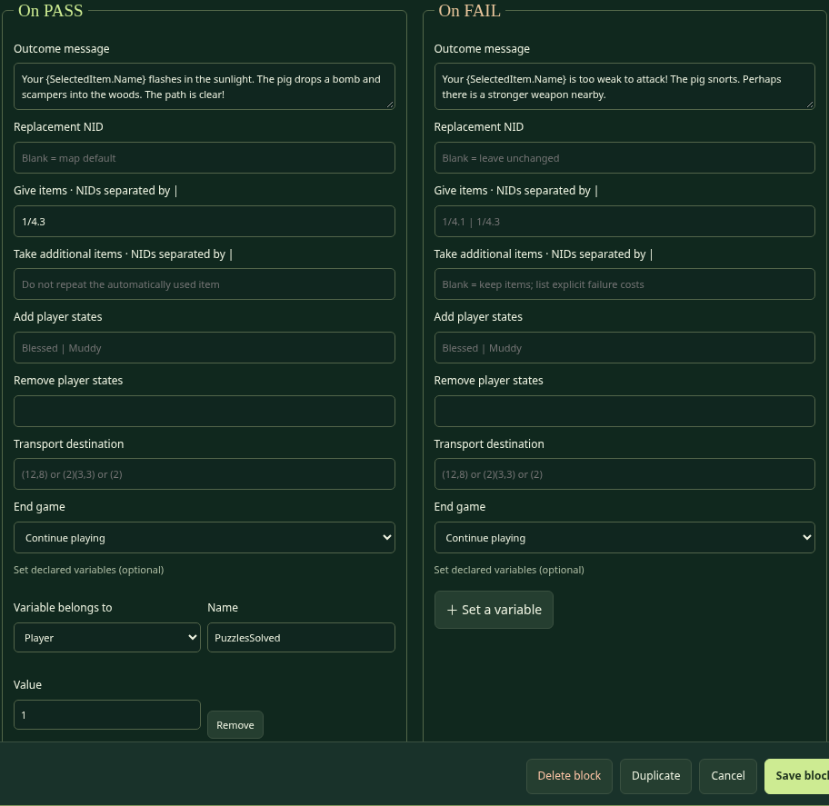

An outcome is a set of effects. A PASS means the chosen tests matched. A FAIL means they did not. Neither is a random dice roll. Cancel is separate and applies neither outcome.

The game checks needed definitions, item removals, variables, and a destination map before committing an outcome. If a required destination cannot load, it leaves the interaction unapplied instead of spending the player’s key first and getting stuck halfway through.

## Movement and replacement come first in your design

| Result | Ordinary entry rule | Allowed examples |
| --- | --- | --- |
| PASS; replacement is Move | Enter the attempted cell | Door becomes grass or an open-door floor |
| PASS; replacement is not Move | Stay beside it | A repeating chest replaces itself |
| FAIL; any replacement Type | Stay beside it | Wrong key leaves a door; fail turns it to grass but does not enter yet |
| Explicit PASS/FAIL transport | Use the configured destination instead | A failed riddle sends the player to the start |

Replacing a cell never automatically triggers its new block. An outcome changes only the approached cell, not every placement of its block definition. If a chest gives an item but leaves an Interaction in its place, that successful reward is still real even though ordinary movement is not allowed.

## Outcome message — Pass.Message / Fail.Message

**Valid setting:** Optional plain text, stored on one line. A missing message uses a general success/failure line. The form flattens entered line breaks into spaces when saving.

**Example:** PASS: “The key fits! The doorway opens.” FAIL: “That key does not fit. You keep it.” Make the result explain what changed, so the player understands the puzzle instead of guessing whether a click worked.

**Creative idea:** Use a short DIKU-MUD-style moment: a pig snorts, a chest vanishes in leaves, or a door folds into a paper bird. Give a fair hint on failure without revealing every answer.

**Connections:** Exactly three placeholders are supported in outcome messages: `{Player.Name}`, `{SelectedItem.Name}`, and `{Target.Name}`. They are case-sensitive and include braces. Other braces remain literal. They substitute plain text; they do not run scripts. Attempt has no selected object, so do not build a message that depends on a specific SelectedItem.Name for that action.

| Placeholder | Meaning | Allowed examples |
| --- | --- | --- |
| {Player.Name} | The nickname entered at game start | Well done, {Player.Name}! |
| {SelectedItem.Name} | The selected item or weapon’s description | Your {SelectedItem.Name} is too weak. |
| {Target.Name} | The approached block’s description | The {Target.Name} shimmers. |

## Replacement NID — ReplaceBlock

**Valid setting:** A full block NID, or blank. Blank PASS means current map default. Blank FAIL means leave the current interaction unchanged. A same-NID replacement is the way to repeat an interaction.

**Example:** PASS replacement `1/1.2` turns mud into gravel. PASS replacement `1/3.2` preserves the sample chest definition so it can be opened again. A separately defined Move “open door” can keep a doorway picture while permitting entry.

**Creative idea:** A chest can magically disappear after giving treasure. A sign can remain indefinitely. A failed magical experiment can transform an obstacle into a different Interaction with new clues.

**Connections:** A reference to another map’s definition loads that definition’s map if needed, but does not transport the player. Its Type still controls ordinary PASS entry. You cannot use raw numeric layout index 10 here, and you cannot use 777 as an ordinary NID reference. Another map’s file must exist in the master directory before its definition can load.

## Give items — GiveItems

**Valid setting:** Zero or more full Inventory NIDs separated by ` | `. Repeat a NID to give multiple copies. Blank gives nothing. Both PASS and FAIL forms can give rewards, although most puzzles use PASS.

**Example:** `1/4.1 | 1/4.3 | 1/4.3` gives a standard key and two bombs. A monster can drop a bomb; a chest can contain boots and a sword. Do not include a wall or grass NID in an inventory list.

**Creative idea:** A failed riddle might give a consolation clue item without allowing entry. A generous chest could be a temporary designer’s testing chest containing every useful item.

**Connections:** These items do not need their own placed cells to be awarded, but their Inventory definitions must exist. Foreign-map items retain their originating NIDs and require that map’s directory entry. Repeating a reward-producing Interaction can create unlimited items if it keeps replacing itself; decide whether that is intentional.

## Take additional items — Pass.TakeItems and Fail.TakeItems

**Valid setting:** A list of full regular Item NIDs, separated by ` | `, on either PASS or FAIL. Clothing and weapons cannot be consumed this way. Repeated entries require repeated owned copies. Blank removes no additional objects. A failed selected item is never removed automatically.

**Example:** An Attempt toll with Inventory.Quantity GreaterOrEqual 2 can remove two tokens by listing the token NID twice. A UseInventory toll already consumes the selected token automatically, so list it only once more if the intended total cost is two.

**Creative idea:** Trade several collectibles for passage or a reward. An enemy can pocket a gold coin after a failed riddle or a weak attack. Tell the player the cost before they choose, and put a spare-coin chest nearby so a failed puzzle can be tried again.

**Connections:** A successful UseInventory selection consumes one regular Item automatically. Listing the same NID in PASS Take additional items is an extra cost, not a reminder. FAIL takes only the explicitly listed copies: if you list the selected item’s NID there, one copy is removed, with no automatic extra charge. Every required copy must be owned before applying the outcome. Items awarded in Give items during this same outcome cannot pay the cost. A missing copy or equipment NID causes an authoring error and applies no effects: no reward, replacement, state change, variable update, transport, or partial removal. Cancel never takes anything.

| Outcome | Automatic selected Item cost | Allowed examples |
| --- | --- | --- |
| PASS with UseInventory | One selected regular Item, plus every listed cost | Selected key plus Pass.TakeItems: 1/4.3 spends a key and a bomb |
| FAIL | None; only the listed regular Items | Fail.TakeItems: 1/4.7 takes one defined gold coin |
| FAIL with repeated NIDs | One copy for each listed occurrence | List 1/4.7 twice to take two coins |
| Cancel / Leave | None; outcomes do not run | Leave a trickster without answering |

To build the coin-stealing enemy, first create an Inventory block with Item kind Item and full NID such as `1/4.7`. Name it Gold Coin and make sure the player can collect a coin before reaching the enemy. In the enemy’s Attack choice, keep the weapon-power test. Under On FAIL, put `1/4.7` in Take additional items and write “Your sword is too weak. The pig pockets one gold coin!” The sword remains reusable. The player stays beside the pig unless a transport is explicitly set. The coin definition must be in the map matching its prefix; a foreign-map prefix needs a master directory entry.

Plan for players who run out of coins: provide a clearly labeled alternative choice without a cost, or a reachable repeating supply chest. Repeating a cost-bearing FAIL without its required items reports an authoring error; the game does not invent a coin, allow a negative quantity, or silently skip a listed cost.

## Add player states — AddState

**Valid setting:** One or more state labels separated by ` | `, or blank. Labels are case-sensitive. This adds labels without removing unrelated existing labels.

**Example:** `Blessed | Muddy` gives the player both states. Re-adding Blessed does not create multiple counted Blessed copies; states behave like membership labels.

**Creative idea:** A shrine can grant Blessed for a moon door, while a splashy shortcut grants Muddy so a guard asks the player to wash first.

**Connections:** Read these with Player.State Contains/NotContains. They do not change item State, weapon Power, clothing slots, or movement automatically. State names do not need variable declarations, but every test and outcome must spell the intended label exactly.

## Remove player states — RemoveState

**Valid setting:** State labels separated by ` | `, or blank. Removing a label the player does not have simply leaves it absent.

**Example:** `Muddy` cleans up that condition; `Cursed | Muddy` removes both while preserving Blessed.

**Creative idea:** A fountain can wash away a condition. A one-use blessing gate can test Blessed, then remove it on PASS so the player must earn a new blessing to repeat the route.

**Connections:** Removal affects the player-state collection only. It does not remove inventory or repair clothing. If the same outcome adds and removes the same state, the current engine adds first and then removes, so it ends absent. Avoid contradictory lists; make your intended result clear.

## Transport destination — Transport

**Valid settings:** `(x,y)` for this map; `(MapNumber)(x,y)` for another map; `(MapNumber)` for that map’s starting location. Blank means no transport. Do not add square brackets, extra list bars, or a comma between the two parenthesized parts.

**Examples:** `(3,3)`, `(2)(7,5)`, and `(2)`. A PASS and a FAIL may each have their own destination.

**Creative idea:** A magic gate leads to a clearing; a defeated boss reveals a new map; a failed riddle sends the gnome to the current start. Return paths can lead to a different entrance from the one originally used.

**Connections:** Transport overrides ordinary entry and can land on any in-range block, including a Wall or portal. The arrival cell is not tested or triggered. Moving away redraws its underlying block normally. Invalid coordinates fall back to that destination map’s valid start. A missing map file/directory entry is a different error: it prevents completion, rather than magically creating the map. Never rely on bad data as your intentional transport mechanism.

## End game — EndGame

**Valid settings:** Continue playing (the blank/default UI option), Yes, or No. The stored Yes ends the game after that outcome. No or omitted means continue.

**Example:** A custom final chest can show a victory message and set PASS End game to Yes. Built-in 777 already supplies its own ending.

**Creative idea:** Build a different ending for a secret treasure, a rescued friend, or a completed riddle. A FAIL ending is possible technically, but explain consequences fairly and avoid accidental dead ends in an introductory puzzle.

**Connections:** End game stops further movement; it does not download a save or publish results. A new adventure or reload resets progress. Put the final message and reward logic on the same outcome. Choosing Yes on an early sign would end play even if you did not mean it to be the final goal.

## Set a variable — belongs to, Name, and Value

**Valid settings:** Choose Map or Player for the owner, enter an already declared variable name, and give a nonempty single-line number or text value. Use letters/digits/underscores for names, starting with a letter. Do not repeat the same variable update within one outcome.

**Example:** Belongs to Map, Name BridgeReady, Value 1 writes `Pass.SetMapVariable.BridgeReady: 1`. Choose Player to write a persistent-across-maps story flag instead.

**Creative idea:** A switch can remember a solved riddle so a different block checks it later. A ferry can set a player flag that an island character recognizes.

**Connections:** Declare Map variables in Map settings and Player variables in [PlayerVariables] of the master file. Setting assigns a value; it does not increment or calculate. A setter on the current Interaction’s outcome affects that Interaction’s map before transport, not the destination map. Remove deletes that update row from the form; it does not delete the variable declaration or automatically reset its value.

# 11. Remembering things: variables and conditions

## Choose the right kind of memory

| Memory choice | Best use | Allowed examples |
| --- | --- | --- |
| Inventory ownership | Things the player has collected | Two bombs; one master key |
| Equipment relationship | Things currently worn or wielded | Boots on Feet; sword in a hand |
| Item State | A condition attached to that item definition/instance | Working sword; Cursed relic |
| Player.State | Conditions that can coexist on the player | Blessed and Muddy |
| Map variable | A local progress value in one map | BridgeReady = 1 |
| Player variable | Progress remembered across maps | MetTheKing = 1 |

Suppose a player must cross mud with boots. Equipment.Worn is the right question. Suppose a gate opens after a distant lever is pulled. A map variable is the right memory. Suppose three maps recognize a royal invitation. A player variable or an actual inventory invitation might work, depending on whether the player should choose and spend that invitation.

## A two-block lever puzzle

Declare `BridgeReady: 0` in Map settings. Create an Interaction called Old Lever. Its Pull the lever choice uses Attempt with no tests. On PASS, set Map variable BridgeReady to 1 and keep the lever’s own NID as replacement if it should remain.

Create another Interaction called Folded Bridge. Its Cross choice uses Attempt and tests Map.Variable.BridgeReady Equal 1. On PASS, replace it with a Move plank definition. On FAIL, leave it unchanged and explain that the bridge is still folded.

The lever has not remotely repainted the bridge. It changed a number; the bridge checks that number when approached. This distinction helps you invent switches without assuming a feature the game does not have.

## Session memory is not a saved game

Inventory, equipped items, player states, variables, and changed map cells live in memory during the game. Leaving and returning to a map preserves them. Reloading or choosing New adventure resets the session. Another browser tab has its own session.

Exporting from the editor saves a map’s starting design, not a player’s current adventure. A map variable’s declaration is its initial value for a new game. Do not expect a player who already loaded an older version in a running tab to receive every later file edit automatically; reload to test a new starting design.

## Flat rules and fixed values can still make rich puzzles

You can make a sequence with stages: declare RiddleStage=0, let one correct answer set it to 1, and let another choice require 1 before setting 2. You write each stage explicitly. There is no general “add one” command or automatic arithmetic expression.

Use separate choices for alternatives that need different stories or effects. “Show the royal badge” and “Pay a token” can use different tests and outcomes. One All/Any group should stay understandable. A puzzle that is easy for its author to explain is much easier to debug.

# 12. A recipe book for creative blocks

The following sample NIDs match the bundled Bramblewood Map 1 unless a recipe says otherwise. They do not reuse the Map 3 tutorial’s identities. When inventing your own map, use the NIDs actually assigned in that document and update every related rule/reward.

## Recipe A — Grass and gravel: every Move block starts here

Choose Type=Move, assign a local category-1 NID, give a name and Map image, then Save block. The sample grass is `1/1.1` and gravel is `1/1.2`. No choices or tests are required. Paint the cells where players may walk.

Use gravel as a visual clue leading toward a useful object, even though it moves like grass. An “open door” Move block can keep a doorway picture after a locked-door Interaction passes. Make sure it is really Move; a picture that looks open does not override an Interaction Type.

## Recipe B — Brick and ordinary trees: dependable Walls

Choose Type=Wall with a category-2 NID. Sample Tree is `1/2.1`; Brick wall is `1/2.2`. Set Map image to tree.png or brick.png and Save. These blocks do not offer interactions.

Use walls to give the map a meaningful structure: a narrow passage, a room boundary, or a loop. Place them so the player cannot simply walk around a supposedly important door. A bomb does not automatically work on a Wall. For a removable look-alike tree, use Recipe H instead.

## Recipe C — Standard keys, master keys, and other regular Items

Choose Type=Inventory and ItemKind=Item. Use category-4 NIDs and suitable names/images. In the sample, Standard Key is `1/4.1`, Bomb is `1/4.3`, and Master Key is `1/4.4`. Place them as cells or list their NIDs in a chest’s Give items.

Pickup is automatic through the built-in choices. Using a selected regular item on a matching Interaction consumes one on PASS; a wrong match preserves it unless Fail.TakeItems explicitly lists a cost. The special power of a master key comes from doors testing its NID, not from the word Master in its name.

Creative variations include a flute, a shiny pebble, a ferry ticket, or a mushroom. Each needs an accepting Interaction. Do not assume merely naming an item Bomb makes it remove every nearby wall.

## Recipe D — A standard door and a master door

The sample Standard Door is Interaction `1/3.3`. Give it a UseInventory choice and test SelectedItem.ID Equal `1/4.1`. PASS can show “The key fits,” with blank replacement for grass. FAIL explains that the chosen item does not fit, with blank replacement to preserve the door.

The sample Master Door is `1/3.4` and tests the master key `1/4.4` instead. Give it a different picture or clue to help the player understand which key it wants. The master-key item must exist and be reachable before the door.

To keep a door picture after success, create a category-1 Move “Open Door” and use that NID as PASS replacement. To require a new key each time, preserve the locked Interaction as replacement, but remember: the player stays beside it. Use an explicit transport if such a repeating door should also send the player through. Do not promise ordinary entry through an Interaction replacement.

## Recipe E — Boots and a muddy crossing

Define Trail Boots as Inventory/Wearable `1/4.5`, State Working, WearLocation Feet. The sample mud is Interaction `1/3.5`. Its Try to cross choice uses Attempt and Equipment.Worn Contains `1/4.5`.

PASS replacement `1/1.2` changes mud to gravel and permits entry. FAIL leaves mud in place and tells the player to wear the boots. Carrying boots without equipping them must fail. They remain owned and worn after success; the check does not spend them.

Creative variants include a winter coat for a freezing passage, a disguise for a guard, or gloves for a thorn gate. Define the wearable’s location and NID, then test that NID. The game does not know what “cold” means until you create a rule.

## Recipe F — A strong sword and a weak dagger

The sample Bramble Sword is Inventory/Weapon `1/4.2`, Power 8, Hands 1, State Working. Wooden Dagger is `1/4.6`, Power 2. The player must choose Wield in the pack; pickup alone does not put a weapon in a hand.

Create a two-handed weapon by setting Hands to Both hands. It displaces other wielded weapons, while gloves remain worn. Both the sword and dagger remain owned after failed or successful attacks. There is no automatic durability loss in this version.

## Recipe G — The pig monster: a puzzle with an Attack choice

Use Interaction `1/3.1`, pig.png, RequiredPower 6, and a suitable description. Its Attack choice uses Action Attack with All tests: SelectedItem.State Equal Working, then SelectedItem.Power GreaterThan Target.RequiredPower.

On PASS, let the pig vanish with the default replacement and optionally give Bomb `1/4.3`. On FAIL, use “Your {SelectedItem.Name} is too weak to attack!” The player remains beside the pig and keeps the weapon.

Test four cases: no wielded weapon, weak dagger, power exactly 6, and strong sword. With GreaterThan, exactly 6 must fail. If you want equality to win, use GreaterOrEqual. This is a one-round puzzle result, not an enemy whose HP counts down over several attacks.

## Recipe H — A bomb-removable secret tree

Use an Interaction tree such as `1/3.7`, with the same tree.png as the ordinary Wall tree. Its UseInventory choice tests SelectedItem.ID Equal `1/4.3`. A successful match consumes one bomb and uses the default replacement to clear the path.

FAIL might say “The tree does not budge. Your {SelectedItem.Name} is back in your pack.” It does not spend a wrong key or an unsuccessful bomb. The player discovers this popup by attempting to enter the special tree, while neighboring Wall trees only block movement.

Put the bomb before the shortcut, and decide whether the shortcut is optional. If a bomb is required for the only route, make sure the player cannot spend every available bomb on another required successful puzzle first.

## Recipe I — A disappearing chest

Use Interaction `1/3.2` with chest.png. Open the chest uses Attempt with no tests. PASS Give items might be `1/4.5`, and blank replacement means the map default. A playful message explains that the boots were found and the chest vanished.

For several treasures, list several NIDs. For two bombs, repeat `1/4.3 | 1/4.3`; do not type a made-up quantity expression. Each reward definition must be Inventory and exist even if that item is never painted separately on the map.

## Recipe J — A locked or replenishing chest

A locked chest uses UseInventory and a matching-key test just like a door, but its PASS Give items contains the treasure. If the chest is supposed to disappear afterward, leave replacement blank. If a key is selected successfully, it is consumed automatically once.

A replenishing chest uses Attempt, no tests, a reward list, and its own NID as PASS replacement. Each approach can grant another reward while the player stays beside the chest. This can be a friendly recovery mechanism that supplies spare keys, or a deliberate cheat chest for testing.

Think about the consequence: unlimited rewards may bypass a scarce-item puzzle. If you want one reward only, use default replacement or a different, empty interaction definition after success.

## Recipe K — A transport gate and its return gate

The sample gate `1/3.6` uses Attempt, no tests, PASS replacement `1/3.6`, and PASS Transport `(2)`. The gate remains in the source map, but transport sends the player to map 2’s start regardless of that replacement’s Type.

The map 2 return gate can use `(1)(14,6)`. It lands on the original gate’s cell without retriggering it. The player must move away and deliberately approach again to interact again.

Both maps need entries in the same selected game configuration (main-config.txt for the legacy main collection). Keep their start coordinates valid. You can also use a same-map `(x,y)` gate for a shortcut or a FAIL transport for a trickster riddle. A transport target number is not automatically updated when you renumber a different file.

## Recipe L — A readable sign that does not vanish

Make an Interaction with a sign picture and informative Popup message. Use an Attempt choice called Read the sign, no tests, and the sign’s own NID as PASS replacement. The sample sign is `1/3.8`.

The player stays beside the sign because its replacement is Interaction. If you leave replacement blank, the sign disappears into the map default after reading. That may be a funny magical sign, but choose it deliberately. Cancel text such as Leave the sign lets the player dismiss it without applying a reading outcome.

## Recipe M — A blessing and a condition gate

Create a shrine Interaction with Attempt, no tests, PASS Add player states Blessed, and an appropriate replacement. Create a separate gate whose Attempt tests Player.State Contains Blessed. The gate can remove Blessed on PASS if the blessing should be spent.

This spends a state label, not an Inventory item. The AddState label needs no declaration, but its spelling must match the test. Use a clear message explaining the blessing so the player knows it matters.

## Recipe N — A progress switch and a final garden

Declare GardenOpen=0. A switch sets Map variable GardenOpen to 1. A garden entrance tests that same local flag and becomes Move after success. Put the switch on a reachable side of the puzzle.

This is a useful model for “do A before B” stories. It is also a reminder that the switch does not remotely alter other cells automatically. Those cells need their own tests when approached.

## Recipe O — The princess and a custom ending

For the built-in ending, paint palette block 777 at the goal. It immediately passes its supplied interaction and shows the selected game’s ending title/message/picture, ending movement. Without customization it retains the princess ending. It has no editable ordinary NID and needs no block definition.

For a different ending, create a normal Interaction with a final choice, your own picture, an outcome message, and End game Yes. You can require an item, equipment, state, or progress variable before that ending passes. End game does not save progress to disk, so test after a fresh adventure too.

# 13. Artwork and every preview control

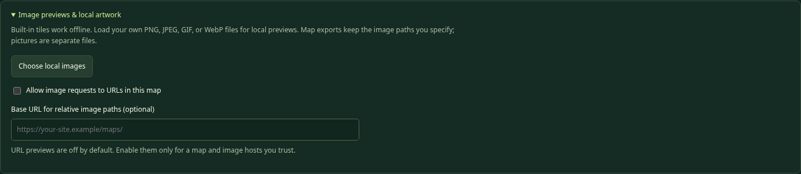

## Choose local images

This opens a picture picker. It accepts PNG, JPEG, GIF, and WebP. Choose files up to 2 MB each, with dimensions no larger than 4096 pixels in either direction. A batch may include at most 64 pictures totaling 15 MB. The whole local preview library is limited to 64 names and a 20 MB stored-data budget.

The editor matches pictures by filename. If the block path ends in `crystal.png`, choosing a local picture named crystal.png provides its preview. A later picture with the same filename replaces that preview. Use distinct filenames when two pictures are different.

Large pictures are downscaled to a small editor preview; the original file is not changed. These preview pictures are not included in map.txt or remembered after reloading. Publish the original files separately. The 32×32 game view rewards simple, readable art, especially for keys and equipment.

## Built-in previews

Standard tile previews are embedded in editor.html and recognized by their filenames. They work offline without an assets folder beside the editor. A local picture with the same name can override the preview. The embedded preview is a convenience, not a promise that your published assets folder contains that picture.

The standard filenames include grass.png, gravel.png, tree.png, brick.png, pig.png, chest.png, key.png, master-key.png, door.png, master-door.png, mud.png, boots.png, sword.png, dagger.png, bomb.png, portal.png, sign.png, and princess.png. The player gnome image belongs to the main configuration rather than a normal map block.

## Allow image requests to URLs in this map

This checkbox is off by default. With it off, opening an unfamiliar map does not automatically request its arbitrary remote image hosts. Built-in and chosen local previews still work, and registered same-origin catalog images may preview directly.

Enable it only when you trust the map and its picture hosts. It permits supported URL previews, not program scripts or map uploads. A relative custom image may also need the base URL field. Turning it on does not rewrite your map paths or solve a hosting permission error.

## Base URL for relative image paths

This optional field tells the editor where to resolve relative custom preview URLs when URL previews are enabled. Use a valid base such as `https://your-site.example/maps/`, including the trailing slash for a directory.

For a map image `../assets/crystal.png`, that base resolves to `https://your-site.example/assets/crystal.png`. A full HTTPS image URL does not need a base. When hosted without a custom base, a website map uses its actual URL, a new/local map uses the selected game folder, and the legacy main game uses the maps directory; offline custom files are better previewed through the local picker.

This is only an editor preview setting. It is not exported and does not change where the game looks. The game resolves its image paths from the actual map file URL. If WordPress puts a map and picture in different upload folders, copied full URLs are often simpler.

## Image paths and WordPress

Use HTTPS URLs on a public HTTPS site. The game rejects script/data/local-file schemes and only permits HTTP for same-origin development. Some WordPress installations reject SVG, HTML, or JavaScript uploads; do not enable unrestricted uploads to bypass a host’s rules. PNG artwork and text specifications are the intended media-file choices, subject to the site’s permissions.

Opening an exported map in the editor does not bundle its pictures. A working local preview is only the art preview step. Test that the actual published picture URLs load in the game, and check popup art separately.

# 14. Import, export, backups, and safe editing

## What Open map file actually reads

Choose a UTF-8 `.txt` or `.ini` map file up to 2 MB. The editor reads its sections, block definitions, choice fields, variables, and layout. It expands the layout into a full editable grid. A fatal structure error leaves your existing document untouched and shows an error message.

Layout errors follow the game’s forgiving rules. A bad longhand row or shorthand physical line is skipped as a unit. Earlier/default cell values remain. The original warning names the file line and, for longhand, the world Y row. Review those warnings: the editor cannot invent the missing intended wall or key.

When an original text file is available, Download original imported text lets you keep that unchanged input while working in the current document. Opening a different document replaces that retained input. Export is a new file, not an overwrite of that original.

## What stays the same and what is normalized

Names, IDs, supported field values, choices, variables, and the expanded layout are retained. Unknown fields and sections are retained with notes rather than secretly becoming new game features. Comments are collected together at the top, not kept beside their original fields. Whitespace and formatting are normalized.

Export rebuilds placement text from the grid. Shorthand writes nondefault horizontal runs; Longhand writes every row from highest Y to lowest Y. A complicated series of overlapping original shorthand entries becomes a simpler description of the final cells. That is expected, not lost gameplay.

## What Export map.txt checks

Export runs the shared game parser plus editor reference checks. It blocks invalid dimensions, wrong NID categories, missing local references, illegal consumptions, undeclared local variable uses, and other reported errors. Fix the listed errors before trying again.

Notes about foreign-map NIDs, destination maps, or player variables do not block export because those belong to other files. They are tasks for you to verify, not certificates that the other files are correct. An exportable map is not automatically a solvable map.

The download is plain UTF-8 text named `map-N.txt`. Some browsers place repeat downloads in map-N (1).txt. Either rename it carefully when replacing the game file or update the master URL. A changed map number does not automatically change every saved copy on your computer.

## Text / INI and Apply text

The text window is a full map specification editor, not a JavaScript console. Apply text parses it and updates the current map if the structure is acceptable. It does not publish or automatically download anything. Use it for unfamiliar future fields, bulk text edits, or learning how the forms translate into sections.

Cancel discards unfinished text edits. A failed Apply text leaves the map unchanged. A successful text application can be undone. Read layout warnings after applying hand-edited text, because a skipped line can leave defaults where you expected obstacles.

## Duplicate, delete, and rename safely

Duplicate creates a new block definition with a free index and NID. A copied self-replacement follows the copy’s new NID. Other intended references, such as a door accepting an existing key, stay connected to those same items. Duplicating a definition does not paint a new cell.

Delete replaces placements with the default block. The editor prevents deletion of a current default/border block or a block referenced by another choice until you fix those relationships. Removing a definition’s own choices is different from deleting an individual placed cell; use Erase for a cell.

The index and NID are read-only in forms. Changing Type or map number updates recognized local references, including SelectionItems, but cannot update other map files, configuration files, or URLs already published. Advanced Text / INI edits require you to correct those relationships yourself. Keep a short reference notebook for cross-map objects, such as “Map 2’s gate accepts map 1 master key 1/4.4.”

## A dependable backup routine

Export before a large resize, after finishing a block, before changing map identities, and before trying raw-text edits. Keep a dated backup folder separate from the live game folder. For a design experiment, duplicate the downloaded map file on disk or export a clearly named backup before you begin.

Undo is helpful but temporary. It has limited history, resets on a new/open document, and does not restore pictures you never saved separately. Do not close the browser just because a block form said Save; export the complete map first.

# 15. Reading the map specification yourself

The format resembles old INI/config files but is a custom Maze Craze format. Standard INI tools may not understand its colons, map rows, or choice/test notation. It contains data, never user-written scripts.

## Section and value rules

Headers use brackets, such as `[Map]`, `[Block.10]`, and `[Block.10.Choice.1]`. A field is `Name: value`, with a colon and a space. Put a new field on a new line. Names and settings are case-sensitive.

Use ` | ` between list entries or test parts. Use commas only inside coordinates. Reserve vertical bars for structure. A line beginning with a semicolon is a comment; inline comments are not supported. Blank lines have no meaning. Do not add quotes around ordinary values; quotes become part of the text.

Numbered definitions, choices, and tests begin at 1. Duplicate section names and duplicate field names are errors. Do not create Block.0 or a custom Block.777. Unknown fields can be retained as notes, but the game ignores them; spelling a new field does not add program logic.

## Shorthand map data

```text
[MapData]
Format: Shorthand
(1,7)3(5) | (6,4)10
(9,6)777
```

The first entry places five copies of local block index 3 from `(1,7)` through `(5,7)`. It always extends right, increasing X. The next entry places block 10 at `(6,4)`. No count means one. The last entry places the built-in ending.

The game fills defaults first, then applies valid lines in order. Last valid entry wins when placements overlap. If any entry on a physical shorthand line is invalid, none of that line is applied; splitting unrelated experiments across separate lines makes problems easier to isolate.

## Longhand map data

```text
[MapData]
Format: Longhand
3(5)
3 | 1(3) | 3
3(5)
```

For a width-5, height-3 map, this describes Y=3, then Y=2, then Y=1. Each row expands to exactly five columns. Blank lines and comments do not count as rows. A bad row is skipped without shifting the next data row’s Y assignment. Missing rows retain defaults and produce a note; extra rows are skipped with warnings.

## A complete rule in text

```text
[Block.10.Choice.1]
Text: Unlock the door
Action: UseInventory
TestsMatch: All
Test.1: SelectedItem.ID | Equal | 1/4.1
Pass.Message: The key fits!
Fail.Message: That item does not fit.
```

This example assumes Block 10 is already a defined Interaction and `1/4.1` is a defined regular Inventory item. Blank/omitted PASS replacement means map default; omitted FAIL replacement means unchanged. The test line uses a full NID, not the key’s numeric layout index.

The map file limit is 2 MB, including UTF-8 bytes. Very large messages or many pasted pictures do not belong in it. Image content stays in separate files. Do not paste JavaScript, HTML picture tags, base64 image data, or a whole main configuration into a map file.

# 16. Connecting maps and publishing the game

## The files work as a chain

The game page loads its JavaScript and master configuration. The master registers games and can also retain the legacy main map directory. Each selected game configuration lists its map numbers and map URLs. A map lists block definitions and image paths. Choices refer to full NIDs, variables, and transport destinations. Each part needs the next part to be available.

| Connection | What must agree | Allowed examples |
| --- | --- | --- |
| StartMap to map directory | The starting number has a Map.N entry | StartMap 3 and Map.3 |
| Directory to loaded map | The file’s ID matches its directory number | Map.3 points to a file with ID: 3 |
| Block to NID | Its prefix/category matches map/Type | Map 3 Inventory uses 3/4.1 |
| Choice to object | A referenced NID resolves to the intended definition | Door test accepts 1/4.1 |
| Reward to inventory | Each GiveItems NID is Inventory | Chest gives 1/4.5 boots |
| Rule/setter to variable | Owner and spelling match a declaration | Map BridgeReady in all three places |
| Transport to destination | Map number exists; coordinates are usable | (2)(3,3) |
| Image path to picture | The uploaded file is at the resolved URL | ../assets/tree.png |

## Independent games and their configuration files

A game is a collection of maps with its own title, starting map, variables, artwork, and ending. The master main-config.txt registers games; each child game-config.txt lists its own maps. The included collections are the main Bramblewood adventure, Sebastian’s Workshop Trail, and Esther’s Enchanted Garden. The two new examples each have two connected maps. Their keys deliberately use the same map/NID numbers to demonstrate independent worlds.

Existing master files that contain only [Maps] keep working as the main game. Adding [Games] does not require moving those maps. A Game.main registration explicitly replaces that legacy collection with the referenced configuration, so use it only when deliberately migrating the main game.

```text
[Game]
StartGame: esther
StartMap: 1

[Games]
Game.esther: maps/esther/game-config.txt
Game.sebastian: maps/sebastian/game-config.txt
```

StartGame is a stable label beginning with a letter and containing letters, digits, underscores, or hyphens. Main is case-sensitive: the implicit legacy ID is main in lowercase. StartMap in the master is an optional override for the initial default launch. Omit it to use the default game’s own start. Selecting another game or restarting it uses that game’s own StartMap. Changing the selected game confirms a fresh run, keeps the nickname, and resets inventory, clothing, weapons, states, player variables, map variables, and changed cells across all visited maps.

A child configuration might contain:

```text
[Game]
Title: Esther's Enchanted Garden
Author: Esther
StartMap: 1
WelcomeMessage: Find the garden key and restore the colors.
VictoryTitle: You restored the garden!
VictoryMessage: Well done, {Player.Name}! The flowers bloom again.

[Maps]
Map.1: map-1.txt
Map.2: map-2.txt
```

Child Map.N paths resolve relative to that game-config.txt. A child must list maps, not another [Games] catalog. Both games can have Map 1 and NID 1/4.1. Transports such as (2) refer to Map 2 in the current game. There are no cross-game transports or shared inventory in this edition. Returning to another map within one run retains changes; switching collections creates a fresh run.

Master Images, ImageCatalog, Style, and PlayerVariables provide defaults. A child may override individual entries in those sections. Child maps are their own directory rather than an inherited list. Child Title, Author, WelcomeMessage, VictoryTitle, VictoryMessage, StartMap, and RequestTimeoutMs are its own game settings. If omitted, the title is Maze Craze, author/introduction/custom ending are blank, StartMap is required and must name one of its maps, and timeout is 10000 milliseconds. Missing custom ending text uses the original princess ending.

| Section / field | Valid setting and relationship | Allowed examples |
| --- | --- | --- |
| Game / StartGame | Master’s initial registered game ID | esther |
| Games / Game.ID | Same-origin child configuration URL | Game.esther: maps/esther/game-config.txt |
| Game / Author | Optional plain attribution | Esther |
| Game / WelcomeMessage | Optional plain opening story | Find the garden key. |
| Game / VictoryTitle | Optional title for ending block 777 | You restored the garden! |
| Game / VictoryMessage | Optional ending text with outcome placeholders | Well done, {Player.Name}! |
| Images / Princess | Ending picture, including custom game endings | ../../assets/chest.png |
| ImageCatalog / Name | Catalog image URL relative to its owning config | Tree: ../../assets/tree.png |

Block 777 remains reserved and automatic. Its title/message can now come from the selected game; its picture still uses Images / Princess for compatibility. Choose that picture appropriately for a garden, treasure, or workshop ending. Ordinary authored outcomes with EndGame: Yes use the custom victory title as well, but retain their authored result message.

## Image catalog and the editor’s image suggestions

Add named images under [ImageCatalog] in the master or a child game configuration. Names follow the configuration field spelling rules: start with a letter, then letters, digits, underscores, or periods. Treat capitalization as significant. Paths resolve against the configuration that defines them. Child entries with the same key override the master.

```text
[ImageCatalog]
Tree: assets/tree.png
GoldCoin: assets/gold-coin.png
```

A block may use MapImage: @Tree or InteractionImage: @GoldCoin. The @ means look up that exact catalog name in the current game. An unknown name is an authoring error; it is not a JavaScript expression. Relative and absolute HTTP(S) image paths remain supported, so older maps do not need conversion.

The editor suggestions combine bundled filenames, paths already used in the open map, and the selected game’s catalog. Catalog entries offer both @Name and their resolved URL. Refresh map list rereads configuration/catalog changes after SFTP. Adding a picture to a server folder alone does not enumerate it: add its catalog entry too. Export stores the chosen path or alias; it does not embed picture data.

Same-origin catalog previews may load directly because the author explicitly registered them. Local preview pictures still override matching filenames. Other URL previews stay opt-in through Allow image requests; enabling that uses the actual URL even when a bundled filename matches. Website-map relative previews use that map’s real URL. A local/new map uses the selected game’s folder, or maps/ for the legacy main game, unless the preview base is explicitly provided.

For maps under maps/esther/, ../../assets/tree.png reaches the shared root art. Using @Tree avoids rewriting a map when the catalog is updated. The catalog file itself still needs the correct relative or absolute URL. New map Test from Start uses map-N.txt in that game configuration’s folder as its fallback image base; published map entries use their actual registered URLs.

## Every main-config field you may need to coordinate

The editor does not edit main-config.txt or game-config.txt. These settings are documented here so you know which other file must change. Use a plain-text editor, retain the section headings, and preserve unrelated entries.

| Section / field | Valid setting and purpose | Allowed examples |
| --- | --- | --- |
| Game / Title | Plain browser title text | Maze Craze |
| Game / StartMap | Positive map number in Maps | 3 |
| Game / RequestTimeoutMs | Whole milliseconds, 1000–30000 | 10000 means 10 seconds |
| Maps / Map.N | File URL for map N | Map.3: maps/map-3.txt |
| Images / Player | Gnome avatar image URL | assets/gnome.png |
| Images / Princess | Built-in 777 ending image URL | assets/princess.png |
| Style / Font | Heading font from the approved list | Georgia, System, Monospace |
| Style / MessageFont | Message font from the same list | System |
| Style / Accent | Six-digit hex color | #c9ee87 |
| Style / Panel | Six-digit hex panel color | #172b28 |
| Style / Text | Six-digit hex text color | #f1f5e6 |
| PlayerVariables / a name | Initial numeric/text player variable | MetTheKing: 0 |

Title changes the browser title; it does not renumber maps. RequestTimeoutMs limits file requests, not movement speed or a puzzle timer. Do not set a tiny timeout to make the game harder; it would cause loading failures instead.

Player and Princess are outside normal map block definitions because they serve the avatar and reserved ending. Style fields offer a small approved vocabulary, not arbitrary CSS or external font imports. Keep text/background colors readable; a pale accent on a dark panel works better than nearly identical colors.

PlayerVariables declarations create values every map in the selected game can read or set through the Player scope. A map setting with the same name in [Variables] is a different value. Choose Map or Player intentionally when writing a test or setter.

## Relative URLs depend on which file owns them

A relative Map.N URL is resolved from the configuration containing it: main-config.txt for the legacy main collection, or the selected game-config.txt for a child collection. A relative MapImage/InteractionImage URL is resolved from the map file. A local image preview base in the editor does not change either one.

For example, with main-config.txt in the game root and map-3.txt in its maps folder, `Map.3: maps/map-3.txt` reaches the map, and `../assets/key.png` reaches the root assets folder. If WordPress places the map under a dated uploads folder, inspect the real uploaded URL. Use a full HTTPS picture URL when its relative location is unclear.

## Add a new map without breaking the old ones

Upload/export the new map and pictures first. Add its Map.N entry to the master file. Then create a transport from an existing map, or temporarily change StartMap to test it directly. Add a return gate unless a one-way journey is intentional.

An imported foreign NID does not copy that definition into the current file. The game loads the originating map to resolve it, so that map still needs an entry. A foreign replacement similarly keeps its originating identity; it is not a secret transport command.

## Local play and WordPress hosting

For local game testing on Windows, open a terminal in the full MazeCraze game folder and run `py -m http.server 8000` if Python is installed. On systems using python3, use `python3 -m http.server 8000`. Open the server’s HTTP address in your browser. Keep the terminal open while testing. The Python server is a development tool, not the public production host.

For WordPress, host the static game files in a location that serves HTML, JavaScript, styles, text, and pictures correctly, then embed the game page with the project’s iframe example. A Custom HTML block containing only a copied game page is not a replacement for the external module/configuration files.

The editor itself can be hosted as a single editor.html page for editing. Its integrated playtest also needs the full game files on that same HTTP(S) origin. It reads local map files in the visitor’s browser and exports downloads; it does not write back to your website. Publishing a changed map remains a separate upload step. Ask the site administrator for the intended static hosting directory instead of enabling unrestricted upload types.

# 17. Testing and troubleshooting like a mapmaker

## Test from Start, Back to Edit, and Resume Test

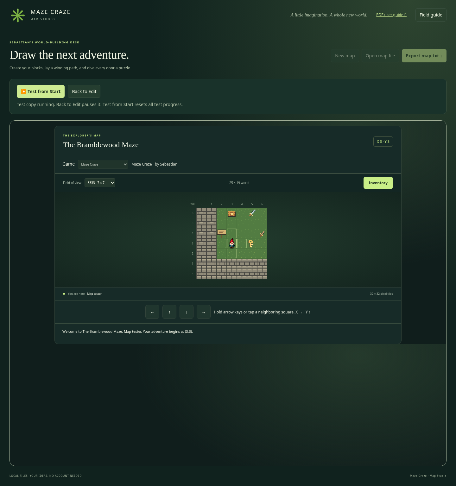

These controls appear above your editing document. Use them on your game website, with editor.html beside index.html and all the game files. The game runs inside a frame, like a small window in the editor. It uses the normal game program and popup choices; there is no second set of puzzle rules to learn.

| Control | What it does | Allowed examples |
| --- | --- | --- |
| Test from Start | Starts a fresh run from the latest applied editor document | Test your new door without exporting |
| Back to Edit | Pauses and hides the current run; keeps its memory and dialogs | Return to graph paper after a failed guess |
| Resume Test | Continues the paused run using its previous map snapshot | Keep your collected sword and current position |
| Export map.txt | Downloads your authoring document, independently of test progress | Save map-3.txt after changing a door rule |

First save any block form and apply map settings. Read Map checks and fix errors. Click Test from Start. Your gnome is called Map tester and begins at this map’s StartingLocation, even if main-config.txt normally starts somewhere else. Use arrows or numpad 8/2/4/6, open inventory, wear boots, wield weapons, and try choices exactly as in the regular game. Click the game grid if arrow keys do not have focus.

Every Test from Start discards the previous test run. Inventory, equipment, player states, player variables, map variables, replacements, and changes on other visited maps all start fresh. The map is copied from the latest applied editor document; the editable design itself is never changed by collecting a key, defeating a monster, or traveling during the test.

Back to Edit pauses the current run without copying its variables back into the editor. The frame simply stays in memory. Even an open interaction or result popup stays there. If a choice is still resolving or another map is loading, the button waits until that work finishes so you cannot pause halfway through an outcome. Return to your graph paper and make changes normally. Undo history is preserved.

Resume Test continues that old run, including its original map design. Editing a door while paused does not change the door in the paused game. The message “Your map has changed. Resume continues the previous test. Test from Start uses your changes.” reminds you of this rule. To try the new door, use Test from Start. This version has no way to change inventory or variables inside a running test by typing designer commands.

**Try it:** Test from Start, collect a key, and choose Back to Edit. Rename the map in Map settings. Resume Test: the old name and collected key remain. Back to Edit, then Test from Start: the new name appears and the key is back on the ground. Export still contains the placed key because testing did not collect it from your design.

### Files and artwork used during a test

The edited map may have a new number that is not yet listed in its selected game configuration. It can still start in Test from Start. Other maps reached by transport and foreign-map item definitions must be listed in the selected game’s directory; the game loads their published files. An unsaved Map 2 open in another editor tab is not shared with this run. On a fresh test, all visited maps begin fresh again.

Styles, player artwork, ending artwork, the image catalog, and player-variable defaults come from the selected game and its inherited master defaults. If the edited map already has a Map.N directory entry, its URL is the base for relative block image paths. Otherwise the base is map-N.txt in the selected game configuration’s folder (maps/map-N.txt for the legacy main game), even though that nonexistent map file is not fetched. Thus ../assets/tree.png points to the normal shared artwork folder. Absolute HTTP(S) image URLs use their own addresses. New custom artwork must be on the server to appear in the game. Choosing a local image preview or changing the editor’s preview base does not send that artwork to the game.

### Offline use, publishing, and restarting the browser

Double-clicked editor.html still supports drawing, forms, import, and export. Test from Start explains that playtesting needs HTTP(S); it cannot run the module-based game from a file:/// address. The editor-only download does not include the game. Use the full project download for integrated testing, and deploy editor.html, index.html, styles.css, and the complete js/ folder together, including playtest-protocol.js. Keep maps, main-config.txt, and assets in their normal places.

The map snapshot is a browser message to the same-origin game frame. It is not an HTTP POST, upload, server save, or replacement of the live map file. The server only serves ordinary game files and artwork. Export the final map and SFTP it to publish, as usual. Exporting does not destroy a paused test. Reloading or closing the editor loses that test and any unexported edits; paused progress is not a save file.

If the game cannot become ready, the editor returns to the design and shows a loading error. Check the complete deployment and main-config.txt URL; refresh after replacing old scripts. A test failure never erases the editable map.

## Test one new idea at a time

First confirm the route with simple grass, walls, key and door. Add one equipment puzzle next. Then add a secret route or another map. Use Test from Start between changes, and export backups regularly. This makes it much easier to find which new idea introduced a problem.

For each choice, write an expected PASS and FAIL case. Test with no eligible item, a wrong item, the right item, and repeated attempts. For a weapon, test weaker, equal, and stronger power. For clothing, test owned-but-not-worn, worn-and-Working, and a displaced item.

Check inventory before and after success/failure. A failed bomb match preserves it by default; an explicit Fail.TakeItems list is the exception. A successful selected regular item removes one. A reusable weapon should remain. Check the replacement Type, not only the picture, before expecting ordinary entry.

Walk away and return. Does a repeating chest grant another reward? Does a one-time chest stay gone? Change maps and return: cells and session memory should persist. Start a fresh adventure when testing initial conditions.

## Common problems and precise fixes

### The game reports a file:/// or CORS module error

You opened the game from disk. Serve the full game over HTTP(S). The standalone editor may be opened directly, but the game loads modules and configuration files. On a website, also verify that js/app.js is present and served as JavaScript rather than an HTML error page.

### A picture works in the editor but not in the game

The editor may be using an embedded standard preview or a locally selected picture. Upload the real image and check the path from the map file’s URL. Preview images are not exported. Check spelling, letter case, extension, and WordPress-renamed files. Test popup pictures separately.

### The popup appears, but there is no key/weapon to select

UseInventory offers regular Items, not Weapons/Wearables. Attack offers only wielded Weapons. A collected sword must be wielded in the pack. If there are no eligible objects, the game gives guidance without resolving the choice; that is not a FAIL outcome.

### A correct-looking key fails

Compare the exact selected item NID with the test value. Map 1 key 1/4.1 is different from map 2 key 2/4.1. A name or image that looks right does not override identity. Check case for any State test and confirm you used Action UseInventory rather than Attempt.

### The player has boots, but mud still blocks the way

Open the pack and Wear the boots. Check that the item’s NID matches Equipment.Worn, State is Working, and another overlapping wearable has not put the boots away. Inventory ownership and worn equipment are different relationships.

### A power-6 weapon fails against Required power 6

GreaterThan is strict, so 6 is not greater than 6. Use GreaterOrEqual if equal values should win. Check the single selected weapon, not a sum of both weapons or the player’s name/health.

### A PASS gives a reward but does not move the player

Look at the replacement. Ordinary entry requires PASS plus a Move block. A self-replacing chest or door is still Interaction, so the player stays beside it. This is expected. Use a Move replacement or an explicit transport if movement should occur.

### A sign, chest, or portal vanished unexpectedly

Blank PASS replacement means default floor. Enter the same Interaction NID if it should remain. For a portal, keeping it and explicitly transporting elsewhere is a useful combination. For a sign, preserving it means the player stays beside it after reading.

### A toll or door removes too many keys

UseInventory already consumes the selected regular key on PASS. Take additional items is extra. Remove a duplicated cost or provide the intended quantity rule. Check both PASS and FAIL Take additional items. FAIL removes only explicitly listed regular Items; leave that field blank when a wrong match should preserve everything.

### A variable produces an error or never changes as expected

Check its declaration, exact name, and scope. Map variables live in that map’s settings; Player variables live in the main file. Setting a value is assignment, not addition. A setter does not repaint a distant block; that block needs a rule reading the variable.

### A foreign reference is listed as a note

Verify the originating map’s Map.N entry, its uploaded file, the referenced Inventory/Move definition, and the exact NID. The editor cannot inspect every other file from a single local map, so a note is a reminder to test that relationship in the game.

### A transport goes to the start instead of the chosen spot

Check parentheses, X/Y order, and destination dimensions. Invalid coordinate data falls back to that map’s start. An explicit `(2)` intentionally uses map 2’s start. A missing destination file is a loading failure, not the coordinate fallback case.

### A transport lands on a door or wall

That is allowed. The game does not test arrival cells. Moving away uses the surrounding cells normally, and the underlying destination remains. Ensure at least one useful neighboring route if the landing should be escapable.

### A map cannot export

Open Map checks and read the first error. Common causes include a missing local NID, a default that is not Move, an Interaction with no choices, a malformed rule, an undeclared local variable, or a forbidden image scheme. Fix the actual reference rather than inventing a new field to bypass it.

### An imported wall row or item is missing

Read the original skipped-line warning. An invalid entry can reject an entire shorthand line or longhand row. The editor retained defaults/earlier cells instead. Download the original imported text if needed, inspect the named line, and repair the grid or source before export.

### The new map never appears in the game

Export is not upload. Confirm the file is in the game location, Map.N points to that actual URL, its ID matches N, and StartMap or a transport reaches it. Check repeat-download filenames. Reload/clear the relevant site cache when testing a newly uploaded version.

### Undo does not reach an old version

History is limited and resets when another document opens. Local images and unfinished closed forms are not map-history snapshots. Restore a disk backup instead. Export milestones before major experiments.

## A fair-puzzle checklist

- Every required key, bomb, or wearable is reachable before its first required use.
- The number of consumables is enough for the required successful uses.
- Optional shortcuts do not quietly spend the only item needed to finish.
- The player gets clues about wearing, wielding, and special key identities.
- A successful replacement has the intended Type, not merely the intended picture.
- Every transport has a usable destination and a way forward or a deliberate return path.
- A fresh game can reach the ending without designer-granted items.
- Someone who did not build the map can explain why each required puzzle worked.

# 18. Quick references, sample catalog, and next challenges

## The bundled Bramblewood definitions

This catalog matches the example file included with this editor edition. It is a reference, not a rule that every new map must copy. Your Map 3 practice definitions use their own prefix and creation order.

| Block index | Definition and Type | Allowed example reference |
| --- | --- | --- |
| 1 | Grass; Move | 1/1.1 |
| 2 | Gravel; Move | 1/1.2 |
| 3 | Tree; Wall | 1/2.1 |
| 4 | Brick wall; Wall | 1/2.2 |
| 5 | Pig monster; Interaction | 1/3.1 |
| 6 | Mossy Chest; Interaction | 1/3.2 |
| 7 | Standard Key; Inventory/Item | 1/4.1 |
| 8 | Bramble Sword; Inventory/Weapon | 1/4.2 |
| 9 | Bomb; Inventory/Item | 1/4.3 |
| 10 | Standard Door; Interaction | 1/3.3 |
| 11 | Master Door; Interaction | 1/3.4 |
| 12 | Master Key; Inventory/Item | 1/4.4 |
| 13 | Deep Mud; Interaction | 1/3.5 |
| 14 | Trail Boots; Inventory/Wearable | 1/4.5 |
| 15 | Lantern Gate; Interaction | 1/3.6 |
| 16 | Secret interaction Tree | 1/3.7 |
| 17 | Wooden Dagger; Inventory/Weapon | 1/4.6 |
| 18 | Wayfarer’s Sign; Interaction | 1/3.8 |
| 777 | Built-in princess ending | Place 777; no ordinary NID |

## Before you export

- Save the block form and Apply settings first.
- Read errors and notes; verify foreign-map/player-variable relationships elsewhere.
- Check all starting and transport coordinates against dimensions.
- Keep picture files separately and verify their final URLs.
- Export, retain a backup, put the file in the game location, and update main-config.txt if needed.
- Play the result through HTTP(S), including wrong choices and a fresh start.

## Try these design challenges

**Two solutions:** Build a crossing with Any: working boots worn OR the player is Blessed. Tell the story so both solutions feel reasonable. Test each solution alone, then neither.

**One image, two meanings:** Place several Wall trees and one visually identical Interaction tree. Write a clue that makes finding it satisfying rather than pure guessing.

**A useful loop:** Connect two maps with a return gate. Let the second map reward an item defined on the first. Verify the original NID still works when carried back.

**A memory puzzle:** A lever sets a map variable; a later door checks it. Keep the door blocked until the flag changes. Explain why the lever does not need to know the door’s coordinate.

**Equipment choices:** Make a one-foot item and a pair of boots. Watch how equipping one displaces the other. Let different Interactions reward the different worn NIDs, while keeping every route recoverable.

**A generous recovery chest:** Supply spare consumables through a self-replacing chest. Decide whether that makes the map friendlier or destroys a scarcity puzzle. Both can be useful designs if intentional.

## What this edition does not do

There is no player health, random battle simulation, nested rule language, general arithmetic, automatic repair of item State, remote repainting by coordinate, permanent saved-game file, or automatic WordPress publishing. The editor does not edit main-config.txt or pack custom images into map exports. These are boundaries of this version, not puzzles to solve by inventing undocumented field names.

The game and editor are plain JavaScript projects with readable source. If Sebastian invents a mechanic outside the current vocabulary, write the idea in ordinary words first. Decide what the player does, what information is tested, and what changes. Then discuss whether the existing fields already express it or whether a future coding iteration should add it.

## A last word for the mapmaker

Your best tools are a clear clue, a consistent rule, and a fresh playtest. A clever secret does not need a huge world. Start with a small working puzzle, keep the names and coordinates straight, and add one interesting idea at a time.
